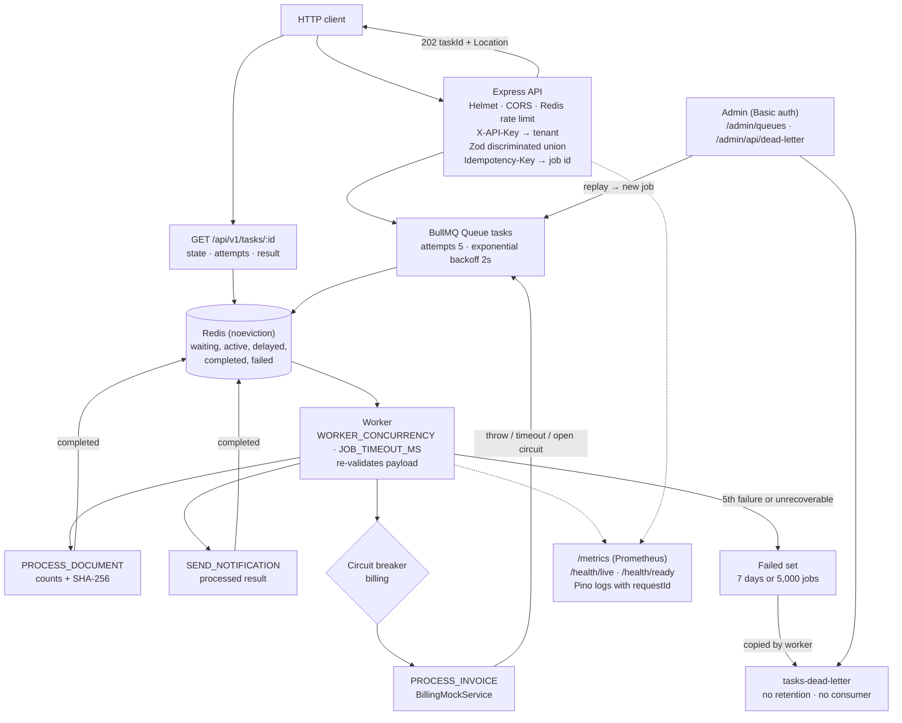

# Distributed Task Queue Engine

One Node.js deployable accepts background work over HTTP, stores it in Redis through BullMQ, and executes it on a BullMQ worker. The API returns `202 Accepted` as soon as Redis has the job. Document analysis, notification handling, and a simulated invoice call then run outside the request, with a fixed retry policy, a per-job timeout, a circuit breaker around billing, a dead-letter queue, Prometheus metrics, and structured logs correlated by request id.

Redis is the only state. There is no second database and no separate message bus. The same image runs in one of three roles selected by `PROCESS_ROLE`: `all` (HTTP and worker in one process, the default), `api` (HTTP only), or `worker` (worker plus `/health` and `/metrics`). Scaling is horizontal at the process level: every worker instance consumes the same `tasks` queue, and every API instance shares the same Redis-backed rate limiter and idempotency keys.

This repository is a working reference for that flow. The invoice handler is a mock that fails on purpose. The notification handler does not call an email provider. The task API is authenticated with per-tenant API keys (mandatory in production) and the admin surface with HTTP Basic auth by default, or optional Keycloak OIDC/SSO with admin/viewer RBAC.

## Key Architectural Highlights

- **Queue.** `POST /api/v1/tasks/process` validates the body with a Zod discriminated union on `type`, then calls `Queue.add` on the BullMQ queue named `tasks`. The job name is the task type. The job data is the validated payload plus a `meta` object: `requestId`, `payloadHash` (SHA-256 of the canonical payload), `acceptedAt`, `effectId`, and, when present, `idempotencyKey` or `replayOf`.
- **Authentication and tenants.** Every task request carries an `X-API-Key` header that must match one of `API_KEYS`. An entry written as `tenantId:key` maps the key to a stable tenant, so several keys can share one tenant and a key can be rotated without losing access to its tasks; a plain `key` entry is its own tenant, identified by `key-<first 16 hex of sha256(key)>`. The tenant is stored in `meta.tenantId`. Optionally, `RATE_LIMIT_TENANT_MAX` caps requests per tenant (all of its keys together) per window. A tenant can only read its own tasks: another tenant's id returns `404`, the same as an unknown id. With `API_KEYS` unset (allowed only outside production) every caller shares the `public` tenant.
- **Idempotency.** An optional `Idempotency-Key` header (1–255 printable ASCII characters) becomes the BullMQ job id `idem-<sha256(tenantId + key)>`, so two tenants can use the same key independently. `Queue.add` with an existing id is atomic and does not create a second job, so concurrent duplicates converge on one job. The service then reads the stored job: same payload hash returns `202` with the original `taskId` and `acceptedAt` plus `Idempotent-Replayed: true`; a different payload returns `409`. The idempotency window equals job retention (see below). Without the header, every request creates a new job.
- **Invoice effects.** A separate Redis effect record tracks `in_progress` and `completed`, payload fingerprint and result for `EFFECT_RETENTION_SECONDS` (default 30 days). Reattempts and DLQ replay retain a stable, tenant-scoped provider key; a completed record returns its stored result without another provider call. An in-progress record is not a lock: a retry may call the provider again with the same key, so the provider must atomically deduplicate it. The local billing simulator does this and records `executions=1` in its own Redis hash. It is not a payment provider.
- **Worker.** `createTaskWorker()` starts a BullMQ `Worker` on `tasks`. `WORKER_CONCURRENCY` sets how many jobs one process runs at once (default 10, accepted range 1–1000). All configuration is parsed once by a Zod schema in `src/config/env.ts`; an invalid value stops the process before it connects to anything.
- **Admission capacity.** Optional `QUEUE_MAX_WAITING` and `TENANT_MAX_INFLIGHT` default to `0` (disabled). Waiting includes paused and prioritized jobs; tenant inflight also includes active jobs, delayed retries and waiting-children jobs. A Redis script checks and inserts atomically across API replicas. Full capacity returns `429` and `Retry-After: 1`; idempotent replays remain available. Tenant admission currently scans inflight jobs, so it is not O(1). The scan reflects Bull Board retry, data edit and removal before the next admission, but Bull Board itself can bypass the limits.
- **Worker slots.** Optional `TENANT_MAX_ACTIVE_SLOTS` limits simultaneous logical executions per tenant across workers. Saturated jobs are delayed briefly without consuming failure attempts. This reduces monopolization but does not guarantee round-robin ordering or a fixed latency bound.
- **Job types.** `PROCESS_DOCUMENT` returns character count, word count, and a SHA-256 of the content. `SEND_NOTIFICATION` records a processed result. `PROCESS_INVOICE` calls `BillingMockService` through a circuit breaker; the mock waits 1.5–3 seconds and throws `BillingServiceException` with probability `BILLING_FAILURE_RATE` (default 0.2).
- **Payload re-validation.** The worker parses `job.data` with the same Zod schema before executing. Redis is a trust boundary: a malformed job (manual insert, schema drift between deploys) throws BullMQ's `UnrecoverableError` and fails once instead of burning five attempts.
- **Payload version.** `schemaVersion` is optional and defaults semantically to `1`; version `1` is currently the only supported value. The API rejects other versions with `400`, and workers reject unsupported stored versions without retrying. Omitting the field and explicitly setting it to `1` have the same idempotency fingerprint, including for previously accepted jobs.
- **Retry policy.** Every job is created with `attempts: TASK_MAX_ATTEMPTS` (default 5) and exponential backoff starting at `TASK_BACKOFF_DELAY_MS` (default 2 seconds). BullMQ computes the delay as `round(delay * 2^(attemptsMade - 1))` with no jitter: with the defaults, 2s, 4s, 8s, then 16s between the five attempts. Billing errors, circuit-open errors, and timeouts are retryable; invalid payloads are not.
- **Per-job timeout.** Each handler runs under `JOB_TIMEOUT_MS` (default 30 seconds) with an `AbortSignal`. The billing mock honours the signal. On expiry the attempt fails with `TaskTimeoutError` and is retried.
- **Visibility and retention.** The worker keeps BullMQ 5 lock defaults: a 30 second lock, renewal at 15 seconds, a stalled check every 30 seconds, and `maxStalledCount` of 1. Completed jobs are kept for 24 hours or 1,000 jobs; failed jobs for 7 days or 5,000 jobs. A job that reaches the terminal failed state is also copied to the `tasks-dead-letter` queue, which has no retention limit.
- **State machine.** A job moves through BullMQ states in Redis: waiting, active, delayed (while backing off), completed, or failed. `GET /api/v1/tasks/:taskId` returns that state, attempts, timestamps, the result, and the failure reason. When the failed set has been trimmed, the endpoint falls back to the dead-letter entry and reports `dead-lettered`.

| Task type           | Sync check                                                 | Worker result                  | Failure mode                                                                                 |
| ------------------- | ---------------------------------------------------------- | ------------------------------ | -------------------------------------------------------------------------------------------- |
| `PROCESS_DOCUMENT`  | `documentId`, `content` (1–1,000,000 chars)                | counts, SHA-256, `completedAt` | Returns on the first attempt                                                                 |
| `SEND_NOTIFICATION` | email, subject, message                                    | `status: "processed"`          | Returns on the first attempt. No provider call                                               |
| `PROCESS_INVOICE`   | customer, amount, currency, tax id, at least one line item | `PAID`, UUID, fake PDF URL     | Throws with probability `BILLING_FAILURE_RATE`; circuit breaker; retried, then dead-lettered |

Redis is reached with `ioredis`. With Sentinel unset, `REDIS_URL` (including `rediss://`) wins. Otherwise the standalone client uses `REDIS_HOST`, `REDIS_PORT`, `REDIS_USERNAME`, and `REDIS_PASSWORD`. Setting both `REDIS_SENTINEL_HOSTS` and `REDIS_SENTINEL_MASTER_NAME` selects Sentinel instead, including for BullMQ's duplicated/blocking clients and Redis coordination. `maxRetriesPerRequest` is `null`, which BullMQ requires for blocking commands. The reconnect delay is `min(500 * 2^min(attempt-1, 6), 30000)` milliseconds. Compose runs Redis with `maxmemory-policy noeviction`, which BullMQ requires: an evicted queue key is a lost job. The Compose Redis requires `REDIS_PASSWORD` (passed through stdin and `REDISCLI_AUTH`, so it never appears in a process list) and is published on `127.0.0.1` only.

Express disables `x-powered-by`, including on the Bull Board sub-app. The task API applies Helmet headers, CORS (`CORS_ORIGINS`), a rate limiter, API key authentication, and a 1 MB JSON limit, in that order. The limiter runs before authentication, so invalid keys are rate limited too. A missing or unknown API key returns `401`. Invalid JSON returns `400`. A body over 1 MB returns `413`. A Zod failure returns `400` with `issues`. A reused idempotency key with a different payload returns `409`. A queue failure returns `500`. Every response has an `X-Request-Id` header; some error bodies also include `requestId`.

## Architecture Diagram



Shutdown order, on `SIGTERM` or `SIGINT`, is HTTP server (idle keep-alive sockets closed), worker (active jobs finish), task queue, dead-letter queue, then Redis. Further signals are logged and ignored while shutdown runs. If shutdown exceeds `SHUTDOWN_TIMEOUT_MS` (default 25 seconds) the process exits with code 1. Compose sets `init: true` so the runtime receives the signal, and `stop_grace_period: 30s`, which is above the shutdown timeout.

## Fault Tolerance & Reliability Patterns

**Exponential backoff and retries.** `defaultJobOptions` sets five attempts and `backoff: { type: 'exponential', delay: 2000 }`. A handler that throws is delayed and retried. `UnrecoverableError` skips the remaining attempts.

**Circuit breaker.** Workers sharing Redis and `SERVICE_NAME` coordinate billing through the Redis key `<SERVICE_NAME>:circuit:billing`. Atomic scripts use Redis server time and count consecutive completed calls; after `CIRCUIT_BREAKER_FAILURE_THRESHOLD` failures (default 5), calls fail with `CircuitOpenError`. After `CIRCUIT_BREAKER_RESET_TIMEOUT_MS` (default 30 seconds), one worker obtains a half-open probe lease; success closes the circuit and failure reopens it. The lease lasts `JOB_TIMEOUT_MS + 1000` ms so an abandoned probe can be replaced. Generation fencing prevents late completions from changing a newer state, but an operation that ignores abort can continue after its lease expires; billing integrations must support cancellation and idempotency. Configure the same circuit and timeout settings across replicas. A Redis coordination error fails the billing attempt closed and is logged; if billing succeeded but recording its outcome failed, BullMQ may retry, so real billing calls must be idempotent. State metrics and logs are each worker's last observed state, not a live Redis scrape.

**Distributed rate limits.** The IP, authenticated tenant and failed-admin-login counters use separate Redis namespaces under `<SERVICE_NAME>:rate-limit:` and are shared across API replicas. All replicas must use the same service name, windows and limits. Coordination uses a separate connection with no offline queue and a one-second command timeout. To preserve existing availability behavior, store errors are logged and these limiters **fail open**, including the admin login limiter: authentication still applies, but quotas and lockout are not enforced until Redis recovers. Use an upstream rate limiter for protection during Redis outages. Readiness reports Redis failures.

**Timeouts.** `withTimeout` races the handler against `JOB_TIMEOUT_MS` and aborts its `AbortSignal`. This bounds handlers that await I/O. It cannot preempt synchronous CPU work; the document handler is bounded by the 1 MB body limit instead.

**Stalled jobs, which is the visibility timeout.** While a job is active, the worker holds a lock renewed every 15 seconds. If the process dies, the stalled checker returns the job to the queue and the worker logs `Task stalled and will be retried`. A job that stalls twice is failed.

**Dead-letter queue.** When a job lands in the terminal failed state (attempts exhausted, unrecoverable, or stalled past the limit), the worker's `failed` handler runs one Redis Lua script. It checks that the original job is still failed with the same finish time and attempt count, then atomically writes a BullMQ-compatible entry with deterministic id `dlq-<jobId>`, records the failure generation on the original job, and increments the routing worker's Redis-backed metric counter. Concurrent or repeated callbacks for that failure do not increment the counter or recreate an entry after an operator removes it. A later failure of the same original job can be routed again. The marker lasts as long as the original job is retained. Nothing consumes the DLQ. Operators list, replay, or delete entries through `/admin/api/dead-letter`; replay validates the payload against the current schema, enqueues it as a new job with `meta.replayOf`, and removes the entry. The copy still happens after BullMQ commits the failure, not in the same Redis transaction: if the process dies in between, or the Redis script fails, the job remains in the failed set subject to retention but may have no dead-letter entry. Redis Lua prevents interleaving, but does not roll back writes after a runtime error; the script checks key types and relevant metadata before writing.

**Redis reconnect and readiness.** Connection events are logged. Startup pings Redis with a 10 second timeout and exits with code 1 if unreachable; Compose restarts the container. After startup, a disconnect does not exit the process; ioredis keeps retrying and `/health/ready` returns `503` until Redis answers a ping within one second. `/health/live` never touches Redis, so an outage does not restart healthy processes.

**Graceful shutdown.** See the shutdown order above. Each step logs a failure, sets `process.exitCode`, and does not skip the remaining steps. A startup failure runs the same sequence. `uncaughtException` logs and shuts down; `unhandledRejection` is logged.

## API Reference

The machine-readable contract is [openapi.yaml](./openapi.yaml), validated in the unit suite. It is not served over HTTP.

| Method & path                                | Auth                      | Purpose                                                                                        |
| -------------------------------------------- | ------------------------- | ---------------------------------------------------------------------------------------------- |
| `POST /api/v1/tasks/process`                 | `X-API-Key`, rate-limited | Enqueue a task. Optional `Idempotency-Key`, optional `X-Request-Id`. `202` with `Location`     |
| `GET /api/v1/tasks/:taskId`                  | `X-API-Key`, rate-limited | Task state, attempts, timestamps, result, failure reason. `404` for other tenants' tasks       |
| `GET /health/live`                           | none                      | Liveness. Always `200` while the event loop responds                                           |
| `GET /health/ready`                          | none                      | Readiness: not shutting down, Redis ping, worker running. `200` or `503` with per-check detail |
| `GET /metrics`                               | none                      | Prometheus exposition (disable with `METRICS_ENABLED=false`)                                   |
| `GET /admin/queues`                          | Basic                     | Bull Board for `tasks` and `tasks-dead-letter` (read-only)                                     |
| `GET /admin/api/dead-letter?limit&offset`    | Basic                     | Paginated dead-letter entries, including each entry's `tenantId`                               |
| `POST /admin/api/dead-letter/:taskId/replay` | Basic                     | Re-enqueue as a new job owned by the original tenant; `202` with `taskId` and `replayOf`       |
| `DELETE /admin/api/dead-letter/:taskId`      | Basic                     | Discard an entry; `204`                                                                        |
| `GET /admin/api/audit?limit`                 | Basic                     | Newest admin audit records (1–1000, default 100)                                               |
| `POST /admin/api/secrets/reload`             | Admin                     | Reload API keys on this replica and audit the result                                           |

With `ADMIN_AUTH_MODE=basic` (default), the admin surface returns `503` until `ADMIN_PASSWORD` (at least 12 characters) is configured, so a default deployment never exposes it anonymously. Basic credentials are compared in constant time and grant the effective `admin` role. The table above describes this default; OIDC accepts Bearer tokens or browser sessions instead. After `ADMIN_AUTH_MAX_FAILURES` rejected logins (default 10) from one client IP within `ADMIN_AUTH_WINDOW_MS` (default 15 minutes), every `/admin` request from that IP returns `429` until the window ends; successful requests, such as Bull Board's polling, are not counted. Only the `api` and `all` roles mount the task and admin routes.

**Admin audit trail.** Dead-letter list/replay/delete, secrets reload, Bull Board writes, rejected access, failed logins, lockouts and audit reads generate structured audit records. Replay, delete, secrets reload and Bull Board writes first record `pending` with a unique `operationId`, followed by a correlated result (`success`, `error`, etc.); reconcile an unresolved `pending` rather than assuming either outcome. DLQ `404` and invalid requests are recorded without a preceding intent. RBAC `403` is recorded before the response. Records include request/actor identity and relevant task identifiers, not credentials, query strings or payloads. Application HTTP logs also omit query strings.

Records go to structured logs and, when configured, the capped Redis stream `<SERVICE_NAME>:audit:admin` (`AUDIT_LOG_MAX_ENTRIES`, `0` = logs only), readable through `GET /admin/api/audit`. If configured Redis rejects a required intent, the mutation does not start and the request fails; other audit persistence failures are logged and fall back to logs. When Redis audit is disabled, even intents are logs only. Neither Redis, application logs nor WORM are a single transaction with the mutation: a crash can leave `pending`, and Redis failover/trimming can lose records. Bull Board results are recorded after response finish. Optional WORM outbox enqueue and eventual archival are separate, and enqueue or archive failure requires investigation. See the [security and audit runbook](ops/OPERATIONS.md#security-and-audit-checklist).

Replay uses a deterministic ID for the original tenant/task so retry after an enqueue/removal failure does not create another retained replay job. This protection lasts only while that replay job remains in BullMQ; inspect the audit `newTaskId` and reconcile before retrying an ambiguous operation.

## Observability

Logs are Pino JSON on stdout with `service` and `role` on every line. `pino-http` logs each request with its `X-Request-Id` (accepted from the client when it matches `[A-Za-z0-9._-]{1,128}`, otherwise generated, and always echoed). The same id is stored in `job.data.meta.requestId` and appears on worker logs, so one request can be followed from HTTP to the last attempt. `Authorization`, cookies, `Idempotency-Key`, `X-API-Key`, and password fields are redacted. Health and metrics requests are not logged.

| Metric                               | Type      | Labels                                            |
| ------------------------------------ | --------- | ------------------------------------------------- |
| `http_request_duration_seconds`      | histogram | `method`, `route`, `status_code`                  |
| `tasks_enqueued_total`               | counter   | `task_type`, `replayed`                           |
| `task_backpressure_rejections_total` | counter   | `reason` (`queue` or `tenant`)                    |
| `tenant_tasks_inflight`              | gauge     | `tenant` (current jobs in Redis)                  |
| `tenant_active_slots`                | gauge     | `tenant` (unexpired execution leases in Redis)    |
| `tenant_fair_share_deferrals_total`  | counter   | `tenant` (worker deferrals)                       |
| `tasks_processed_total`              | counter   | `task_type`, `outcome` (one per attempt)          |
| `task_processing_duration_seconds`   | histogram | `task_type`, `outcome`                            |
| `tasks_dead_lettered_total`          | counter   | `task_type`                                       |
| `circuit_breaker_state`              | gauge     | `circuit` (0 closed, 1 half-open, 2 open)         |
| `queue_jobs`                         | gauge     | `queue`, `state` (read from Redis at scrape time) |

Node.js runtime metrics (event loop lag, heap, GC) are included. Successful `GET /admin/queues/**` requests (Bull Board polls every few seconds) are logged at `debug` instead of `info`; errors on them are still `warn`/`error`.

`tasks_dead_lettered_total` is read from the routing process's Redis counter at scrape time, so it remains a per-instance counter suitable for aggregation across workers. Its increment is part of the routing script, not a separate in-memory update. Counter keys expire 30 days after their last write or successful scrape; a process restart creates a new counter, as with the other process-local counters. A Redis read failure fails the metrics scrape.

**Distributed tracing (optional).** The SDK is loaded only when `OTEL_ENABLED=true` **and** `OTEL_EXPORTER_OTLP_ENDPOINT` is set; otherwise tracing is a no-op. The OTLP/HTTP exporter appends `/v1/traces` to that base URL; `OTEL_EXPORTER_OTLP_TRACES_ENDPOINT` overrides the full trace URL and the standard exporter header variables apply. `OTEL_SERVICE_NAME` overrides `SERVICE_NAME` for traces. HTTP spans include `request.id`, and task requests add `tenant.id`, `task.id`, and `task.type`. An enqueue producer span injects W3C `traceparent` and `tracestate` into job metadata; each worker attempt creates a consumer span, with a billing child span for invoices and a DLQ child span for failed attempts. The worker span records its observed `circuit_breaker.state`. If the BullMQ failure callback receives a different job object, the DLQ span instead links to the stored producer context. Log lines inside active spans carry `traceId`, `spanId`, and the existing request ID. Retried jobs each create their own attempt span; idempotent replays retain the first job's context.

## Configuration

| Variable                                           | Default                           | Notes                                                                                                                                                   |
| -------------------------------------------------- | --------------------------------- | ------------------------------------------------------------------------------------------------------------------------------------------------------- |
| `NODE_ENV`                                         | `development`                     | The image sets `production`                                                                                                                             |
| `PORT`                                             | `3000`                            |                                                                                                                                                         |
| `PROCESS_ROLE`                                     | `all`                             | `all`, `api`, or `worker`                                                                                                                               |
| `REDIS_URL`                                        | —                                 | Wins over host/port/password                                                                                                                            |
| `REDIS_HOST` / `REDIS_PORT` / `REDIS_PASSWORD`     | `127.0.0.1` / `6379` / —          | `REDIS_PASSWORD` is required by Docker Compose                                                                                                          |
| `WORKER_CONCURRENCY`                               | `10`                              | 1–1000                                                                                                                                                  |
| `QUEUE_MAX_WAITING` / `TENANT_MAX_INFLIGHT`        | `0` / `0`                         | Maximum waiting jobs / per-tenant inflight jobs; zero disables each limit                                                                               |
| `TENANT_MAX_ACTIVE_SLOTS`                          | `0`                               | Maximum simultaneous logical worker executions per tenant across replicas; zero disables the limit                                                      |
| `SECRETS_REFRESH_INTERVAL_MS` / `API_KEYS_FILE`    | `0` / —                           | Periodic refresh interval (zero disables) / mounted file for env-mode API keys                                                                          |
| `JOB_TIMEOUT_MS`                                   | `30000`                           | 1,000–600,000                                                                                                                                           |
| `SHUTDOWN_TIMEOUT_MS`                              | `25000`                           | Keep below the orchestrator grace period                                                                                                                |
| `BILLING_FAILURE_RATE`                             | `0.2`                             | 0–1; `1` forces every invoice to the dead-letter queue                                                                                                  |
| `EFFECT_RETENTION_SECONDS`                         | `2592000`                         | Invoice effect and simulated payment retention; 3600–31536000 seconds                                                                                   |
| `CIRCUIT_BREAKER_FAILURE_THRESHOLD`                | `5`                               |                                                                                                                                                         |
| `CIRCUIT_BREAKER_RESET_TIMEOUT_MS`                 | `30000`                           |                                                                                                                                                         |
| `RATE_LIMIT_WINDOW_MS` / `RATE_LIMIT_MAX`          | `60000` / `300`                   | Per client IP, shared through Redis. `0` disables                                                                                                       |
| `TRUST_PROXY`                                      | `0`                               | Proxy hops to trust for the client IP                                                                                                                   |
| `CORS_ORIGINS`                                     | `*`                               | Comma-separated list or `*`                                                                                                                             |
| `API_KEYS`                                         | —                                 | Comma-separated `key` or `tenantId:key` entries, 32+ characters per key, no duplicates. Required when `NODE_ENV=production` and the role serves the API |
| `ADMIN_USERNAME` / `ADMIN_PASSWORD`                | `admin` / —                       | Admin disabled until the password is set                                                                                                                |
| `ADMIN_AUTH_MAX_FAILURES` / `ADMIN_AUTH_WINDOW_MS` | `10` / `900000`                   | Failed admin logins per client IP before `429`                                                                                                          |
| `AUDIT_LOG_MAX_ENTRIES`                            | `10000`                           | Approximate cap of the admin audit stream in Redis; `0` keeps audit in logs only                                                                        |
| `TASK_MAX_ATTEMPTS` / `TASK_BACKOFF_DELAY_MS`      | `5` / `2000`                      | Attempts per task (1–50) and base of the exponential backoff (10–600,000 ms)                                                                            |
| `RATE_LIMIT_TENANT_MAX`                            | `0`                               | Requests per tenant per `RATE_LIMIT_WINDOW_MS`, shared through Redis; `0` disables                                                                      |
| `OTEL_ENABLED` / `OTEL_EXPORTER_OTLP_ENDPOINT`     | `false` / —                       | Both are required to enable OpenTelemetry tracing over OTLP/HTTP                                                                                        |
| `OTEL_SERVICE_NAME`                                | `SERVICE_NAME`                    | Service name on exported traces                                                                                                                         |
| `METRICS_ENABLED`                                  | `true`                            |                                                                                                                                                         |
| `LOG_LEVEL` / `SERVICE_NAME`                       | `info` / `distributed-task-queue` |                                                                                                                                                         |

## Acceptance and business-effect guarantees

A `202` means the current Redis primary accepted the queue write (or the retained
job was replayed); it does **not** mean the task ran, the effect occurred, the
write was fsynced, or a replica acknowledged it. A primary crash before
asynchronous replication can lose an acknowledged task, its effect record, or
both. `appendfsync everysec` also allows a persistence-loss window; Sentinel is
not zero RPO. Clients should retain the same tenant and `Idempotency-Key` when
retrying an uncertain submission.

For invoices, `effectId` is stable for the same tenant/header, worker retries,
stalled-job recovery and DLQ replay. Without a header, independent submissions
get independent IDs. Worker records store the payload fingerprint and result;
different payloads for a retained effect key fail rather than reuse the result.
The HTTP `409` guarantee ends when the original BullMQ job is removed; a later
conflicting invoice can be accepted and then fail in the worker. Completed effect
records can outlive jobs, but neither result nor protection lasts beyond their
configured retention. The simulated provider's own record expires separately
from its creation time.

Real payments require an independent provider that durably and atomically
deduplicates the propagated key, returns the original outcome on retries, rejects
payload mismatches and retains keys for at least the entire replay/recovery
window. A timeout or crash after a provider commits but before Redis records
completion is an ambiguous outcome: retry or reconcile with the **same key**.
Redis alone cannot atomically commit an external payment; without provider-side
idempotency or reconciliation no exactly-once effect is promised. The local
payment simulator and its counter share the queue's Redis, so they cannot prove
safety across Redis data loss. Notification handling still sends nothing.

To exercise the partial-failure scenario, point `TEST_REDIS_URL` at a **disposable
empty Redis database** (the integration suite flushes it), then run:

```powershell
npm run test:integration -- tests\integration\processing.int.test.ts
```

The test applies a simulated payment, loses the first response and retries with
the same provider key; it checks one effective application and the stored result.

## What Is Not Implemented

There is no transactional outbox for task acceptance or administrative mutations. Optional WORM audit archival is not an atomic dual write with Redis; outbox mode retries after successful enqueue but cannot automatically backfill a failed enqueue. API keys have no self-service issuance or automatic expiry. API key reload does not rotate Redis, OIDC, admin or archive credentials, and Vault token renewal is not implemented. Sentinel restores access to a promoted replica, but asynchronous replication can lose acknowledged writes and is not a zero-data-loss guarantee. OIDC sessions end at access-token expiry, without refresh or immediate token revocation checks. HTTP job idempotency and job results last only as long as job retention; the invoice effect record has a separate retention. Timeouts are per process; the circuit is shared in Redis and counts consecutive completions rather than failures in a rolling time window. The dead-letter copy is not atomic with the failure (see above). The audit stream is capped and lives in the same Redis; optional S3 Object Lock protects successfully archived object versions, but there is no cryptographic audit chain. The billing service is a mock and notifications are not sent. Redis Cluster and Helm/Kubernetes manifests remain future work.

## Testing Strategy

There are two Vitest suites and both run in CI.

**Unit suite** (`npm test`, `npm run test:coverage`): Node environment with `NODE_ENV=test` and `LOG_LEVEL=silent`; `.env` is never loaded while Vitest runs. Redis and the queues are replaced with `vi.mock` stubs, so no test opens a connection. Coverage (V8) is enforced at 85% lines and statements, 83% functions and 78% branches over `src/` (`src/index.ts`, the process wiring, is covered by the integration and Docker smoke tests instead); the run fails below those thresholds. The HTML report lands in `coverage/`.

| Suite                             | Covers                                                                                                                                                                                                                                                     |
| --------------------------------- | ---------------------------------------------------------------------------------------------------------------------------------------------------------------------------------------------------------------------------------------------------------- |
| `tests/task.test.ts`              | Full app via Supertest: validation, all three task types, idempotent replay and `409`, malformed key and JSON, `413`, queue failure `500`, status and dead-letter fallback, API key `401`, tenant isolation, key rotation (`tenant:key`), per-tenant quota |
| `tests/task.processor.test.ts`    | Worker handler: results, retryable billing error, `UnrecoverableError`, timeout with aborted signal, breaker short-circuit                                                                                                                                 |
| `tests/dead-letter.queue.test.ts` | Routing results, Redis failures and per-process counter reads                                                                                                                                                                                              |
| `tests/circuit-breaker.test.ts`   | Threshold, success reset, single half-open probe, reopen on failed probe                                                                                                                                                                                   |
| `tests/operations.test.ts`        | Health, metrics, roles, admin `503`/`401`/`200`, lockout `429`, dead-letter list/replay/delete with their audit records (no secrets), audit endpoint auth, rate limit, dead-letter routing                                                                 |
| `tests/observability.test.ts`     | Trace propagation HTTP → job meta → worker span; audit log lines, Redis stream persistence and error tolerance                                                                                                                                             |
| `tests/bootstrap.test.ts`         | Shutdown ordering, error tolerance, timeout and single run; server close with keep-alive; readiness checks; Redis rate-limit store                                                                                                                         |
| `tests/config.test.ts`            | Defaults, invalid values, `API_KEYS` parsing (`tenant:key`, duplicates, length), retry settings                                                                                                                                                            |

**Integration suite** (`npm run test:integration`, config `vitest.integration.config.ts`): runs the real app, queues and worker against a real Redis, one file at a time, with fast retry settings (3 attempts, 100 ms backoff, breaker threshold 2). Every test starts from an empty database (`FLUSHDB`) and zeroed metrics, so the suite is deterministic. It refuses to start against a Redis that already holds keys (set `TEST_REDIS_ALLOW_FLUSH=true` only for a disposable database) and fails fast with instructions if Redis is unreachable.

| Suite                      | Covers                                                                                                                                                                                                         |
| -------------------------- | -------------------------------------------------------------------------------------------------------------------------------------------------------------------------------------------------------------- |
| `health.int.test.ts`       | `/health/live`, `/health/ready`; Redis unresponsive (`CLIENT PAUSE`) → `503` while live stays `200`, then recovery; reconnection after `CLIENT KILL`; `/metrics`; `X-Request-Id` echo                          |
| `api.int.test.ts`          | `401` without/with unknown key, tenant isolation and rotated keys, idempotent `202` replay and `409`, per-tenant idempotency, `400` validation, request id stored in the job                                   |
| `processing.int.test.ts`   | The three task types complete with schema-valid results; retries with measured exponential backoff until `failed`; circuit opens (`circuit_breaker_state` = 2) and later invoices fail without calling billing |
| `dead-letter.int.test.ts`  | Concurrent atomic routing and deduplication, counter consistency and key-type errors; dead-letter metadata, replay (`202`, new job, read by the original tenant, `404` for others), delete and audit records   |
| `coordination.int.test.ts` | Concurrent failure counting and one half-open probe across Redis connections, stale-result fencing, fail-closed behavior and shared API rate limits                                                            |
| `shutdown.int.test.ts`     | Real HTTP listener: request id propagation, readiness `503` during shutdown, active job drained before Redis closes, ordered steps, new connections refused                                                    |

Run it locally with a disposable Redis on `127.0.0.1:6380`:

```bash
npm run redis:test:up        # docker run --rm redis:7-alpine on 127.0.0.1:6380
npm run test:integration
npm run redis:test:down
```

Use `TEST_REDIS_URL` to point at another disposable Redis. The production image excludes `tests/` via `.dockerignore`.

### Quality gates and CI

```bash
npm run lint            # ESLint: typescript-eslint strict + stylistic type-checked rules
npm run format:check    # Prettier (npm run format to fix)
npm run typecheck
npm run test:coverage   # unit tests + coverage thresholds
npm run check           # all of the above
npm run ci              # check + integration tests + build (needs the test Redis)
```

`.github/workflows/ci.yml` runs three jobs on every push to `main`, every pull request and on demand: **quality** (lint, format, typecheck, unit tests with coverage thresholds and the report as an artifact, build, `npm audit` of production dependencies), **integration** (the integration suite against a `redis:7-alpine` service container) and **image**, which runs only when both pass: it builds the Compose stack with `--scale worker=2`, scans the application image with Trivy (fixable HIGH/CRITICAL findings fail the job), smoke-tests health, metrics, `401`/`400`, a task through to `completed`, admin `401` and the audit API, then stops the stack and fails if any app container did not exit cleanly. Dependabot checks npm and GitHub Actions weekly.

To run the same pipeline locally, use `npm run redis:test:up` followed by `npm run ci`, or run the workflow itself with [act](https://github.com/nektos/act) (`act -j quality`, `act -j integration`).

## Local Execution & Docker Setup

Requirements: Node.js 22 for the host toolchain, and Docker Engine with Compose v2 for the stack. The Dockerfile builds on `node:22-alpine` in four stages: full install, `tsc`, production `npm ci --omit=dev`, then a runtime image that runs as `node` with `node dist/src/index.js` and a `HEALTHCHECK` on `/health/ready`.

### Docker Compose

Copy `.env.example` to `.env` and set at least `REDIS_PASSWORD`, `API_KEYS`, and `ADMIN_PASSWORD`. Compose requires the Redis server password; the production app validates API keys after env/Vault loading. Generate each value with:

```bash
node -e "console.log(require('crypto').randomBytes(32).toString('base64url'))"
```

Then, from this directory:

```bash
docker compose up --build
```

Compose starts Redis 7 with AOF, `noeviction`, and `requirepass` on the `queue-net` bridge network and waits until an authenticated `redis-cli ping` succeeds. The app container starts with `PROCESS_ROLE=all`, `REDIS_HOST=redis` plus `REDIS_PASSWORD`, and every variable in the configuration table forwarded from your shell or `.env` (defaults shown above). It is healthy when `/health/ready` returns `200`. The host port is `${PORT:-3000}`; Redis is published on `127.0.0.1:${REDIS_PORT:-6379}`. Data stays in the `redis_data` volume.

Optional profiles:

```bash
docker compose --profile scale-out up --build       # adds a PROCESS_ROLE=worker container
docker compose --profile scale-out up --build --scale worker=3
docker compose --profile observability up --build   # adds Collector, Jaeger, Prometheus and Grafana
```

The observability profile does not itself enable tracing on existing app/worker containers. With `REDIS_PASSWORD` and `API_KEYS` configured as above, enable tracing and recreate them in PowerShell:

```powershell
$env:OTEL_ENABLED = 'true'
$env:OTEL_EXPORTER_OTLP_ENDPOINT = 'http://otel-collector:4318'
docker compose --profile observability --profile scale-out up -d --build
```

The Collector accepts OTLP gRPC at `localhost:4317` and HTTP at `localhost:4318`; Jaeger is at `http://localhost:16686`, Prometheus at `http://localhost:9090`, and Grafana at `http://localhost:3001`. Ports are configurable in `.env.example`. The Collector, Jaeger and Grafana ports bind to loopback; the existing Prometheus port remains exposed on the host. Grafana provisions Prometheus, Jaeger and the **Distributed task queue** dashboard automatically. The local-only Grafana default is `admin` / `local-observability-only`: set `GRAFANA_ADMIN_USER` and a strong `GRAFANA_ADMIN_PASSWORD` before use. Jaeger and the Collector have no authentication; this profile is for local development, not an exposed production deployment.

To send a task with a known sampled trace ID and open its trace and dashboard:

```powershell
$key = Read-Host 'API key (without tenant prefix)'
$traceId = [Guid]::NewGuid().ToString('N')
$headers = @{ 'X-API-Key' = $key; 'traceparent' = "00-$traceId-0123456789abcdef-01" }
$body = '{"type":"PROCESS_DOCUMENT","documentId":"demo","content":"observability test"}'
Invoke-RestMethod -Method Post -Uri 'http://localhost:3000/api/v1/tasks/process' -Headers $headers -ContentType 'application/json' -Body $body
Start-Sleep -Seconds 10 # allow the SDK and Collector batches to export
Start-Process "http://localhost:16686/trace/$traceId"
Start-Process 'http://localhost:3001/d/queue-engine'
```

Jaeger also supports searching service `OTEL_SERVICE_NAME` (or `SERVICE_NAME`). A successful document trace shows HTTP, enqueue and worker spans; use an invoice to see billing, and a terminally failed job to see DLQ routing. Grafana's rates require at least two Prometheus scrapes, so new panels may initially show no data. Queue-depth queries use `max` across replicas because every process reads the same Redis queue. Circuit gauges show each process's last observed state, not a live consensus.

The app image never reads `REDIS_URL` from `.env`; Compose blanks it and points the containers at the in-network Redis. Do not commit real Redis credentials, API keys, or the admin password.

```bash
docker compose down
docker compose down -v
```

`down -v` deletes the Redis volume.

### Host process

```bash
npm install
npm run check      # lint + format check + typecheck + unit tests with coverage
```

Copy `.env.example` to `.env`. **`REDIS_URL` vs `REDIS_PASSWORD`:** default Docker Compose blanks `REDIS_URL` and uses its in-network Redis. A Vault secret may supply a runtime URL, and explicitly configured Sentinel takes precedence over any URL. On the host without Sentinel, `REDIS_URL` wins when set: leave it empty to use the Compose Redis (`docker compose up redis`, published on `127.0.0.1:${REDIS_PORT:-6379}` and authenticated with the same `REDIS_PASSWORD`), or set it to reach another Redis (for example a managed `rediss://` instance). The same `.env` serves both, as long as `REDIS_URL` is empty when you want the Compose Redis.

To rotate a legacy (plain) API key without losing its tasks, compute its tenant id and map the new key to it:

```bash
node -e "console.log('key-'+require('crypto').createHash('sha256').update(process.argv[1]).digest('hex').slice(0,16))" <old-key>
# API_KEYS=<old-key>,key-<hash>:<new-key>   then, once clients moved: API_KEYS=key-<hash>:<new-key>
```

```bash
npm run dev        # tsx watch src/index.ts
npm run build && npm start
```

The process validates configuration, pings Redis, starts the worker (unless `PROCESS_ROLE=api`), then listens.

Submit a document and read its status (omit `X-API-Key` only when `API_KEYS` is unset in development):

```bash
curl -i -X POST http://localhost:3000/api/v1/tasks/process \
  -H "Content-Type: application/json" \
  -H "X-API-Key: <one of API_KEYS>" \
  -H "Idempotency-Key: document-42-v1" \
  -d "{\"type\":\"PROCESS_DOCUMENT\",\"documentId\":\"document-42\",\"content\":\"A valid document body.\"}"

curl -s -H "X-API-Key: <one of API_KEYS>" http://localhost:3000/api/v1/tasks/<taskId>
```

Expect `202` with `taskId`, `taskType`, `status: "accepted"`, `acceptedAt`, and a `Location` header. Repeating the first request returns the same `taskId` with `Idempotent-Replayed: true`. An invoice body uses `customerId`, a positive `amount`, `currency`, `taxId`, and a non-empty `items` array of `description`, positive integer `quantity`, and positive `unitPrice`. A notification body uses `recipient` (email), `subject`, and `message`.

Open `http://localhost:3000/admin/queues` with the admin credentials to see both queues. Put it behind TLS before exposing it beyond localhost; Basic auth sends the password on every request.

### Optional Keycloak OIDC / SSO and RBAC

`docker compose up -d` remains unchanged: Keycloak is opt-in under `--profile auth`,
and `ADMIN_AUTH_MODE=basic` remains the default. In `oidc` mode Basic is not accepted.
Start the local imported realm without editing your existing `.env` (PowerShell):

```powershell
$env:ADMIN_AUTH_MODE = 'oidc'
$env:OIDC_ISSUER_URL = 'http://keycloak:8080/realms/task-queue'
$env:OIDC_PUBLIC_ISSUER_URL = 'http://localhost:8080/realms/task-queue'
$env:OIDC_CLIENT_ID = 'task-queue-admin'
$env:OIDC_CLIENT_SECRET = ''
$env:OIDC_REDIRECT_URI = 'http://localhost:3000/admin/callback'
$env:SESSION_SECRET = (node -e "console.log(require('crypto').randomBytes(32).toString('base64url'))")
docker compose --profile auth up -d --build
curl.exe --retry 30 --retry-delay 2 --retry-all-errors --fail http://localhost:8080/realms/task-queue/.well-known/openid-configuration
Start-Process 'http://localhost:3000/admin/login'
```

Imported **development-only** users: `admin` / `local-admin-change-me` and
`viewer` / `local-viewer-change-me`. Login redirects to `/admin/queues`; use
`http://localhost:3000/admin/logout` to clear the app session and redirect to
Keycloak logout (confirm SSO logout if prompted) before switching users.
The profile binds Keycloak to loopback on port 8080, uses `start-dev --import-realm`,
and has no persistent Keycloak volume; recreating its container resets local users.
Local HTTP URLs are permitted even though the app image uses `NODE_ENV=production`;
non-local URLs must use HTTPS. Do not expose this demo as a production SSO deployment.

| Variable                 | Meaning                                                                                                                  |
| ------------------------ | ------------------------------------------------------------------------------------------------------------------------ |
| `ADMIN_AUTH_MODE`        | `basic` (default) or `oidc`; no automatic fallback on OIDC failures                                                      |
| `OIDC_ISSUER_URL`        | Internal Keycloak realm URL for JWKS and code exchange; for a host process use `http://localhost:8080/realms/task-queue` |
| `OIDC_PUBLIC_ISSUER_URL` | Exact token issuer and browser-facing realm URL; defaults to `OIDC_ISSUER_URL`                                           |
| `OIDC_CLIENT_ID`         | Client and required JWT audience; default `task-queue-admin`                                                             |
| `OIDC_CLIENT_SECRET`     | Confidential client secret; blank for the imported public PKCE client                                                    |
| `OIDC_REDIRECT_URI`      | Exact registered callback, locally `http://localhost:3000/admin/callback`                                                |
| `SESSION_SECRET`         | Required 32+ random characters, identical across API replicas; rotation invalidates all app sessions                     |

JWTs are verified with `jose` and cached/rotating remote JWKS, RS256 signature,
issuer, audience, subject, issued-at and expiration. Roles come from
`realm_access.roles` or `resource_access.<OIDC_CLIENT_ID>.roles`; `admin` wins if
both are present. Missing roles give `403`. `viewer` may read the board, DLQ and
audit API, but every `POST`, `DELETE`, `PUT`, `PATCH` (and other non-read methods)
under protected `/admin` routes returns `403` before execution.
`admin` retains existing write access, including Bull Board actions on the task
queue and DLQ replay/delete APIs; the DLQ remains read-only **in Bull Board** as before.
Denials use audit action `admin.access_denied`. All administrative audit events
also include `subject` (`sub` or Basic username) and effective `role`, alongside
`actor` (`preferred_username`, falling back to `sub`).

Browser login uses Authorization Code + S256 PKCE, encrypted ten-minute state/
verifier/nonce transaction cookies, and validates the returned ID-token nonce.
The session cookie is encrypted, `HttpOnly`, `SameSite=Lax`, scoped to `/admin`,
and `Secure` with HTTPS (`__Secure-admin_session`). Only local development HTTP
uses `admin_session` without Secure. Each request revalidates the access token;
sessions expire with it (five minutes in the local realm) and require a new login.
No refresh tokens are stored. Cookie-authenticated writes must send the app's
exact `Origin`; Bearer calls do not use this cookie-CSRF check.
Logging redacts cookies and authorization headers and omits callback query
parameters. Stateless cookies can be replayed until expiration if stolen;
logout clears the browser cookie, but does not revoke previously issued Bearer tokens.

API permission checks (PowerShell, no browser/cookies needed):

```powershell
$tokenUrl = 'http://localhost:8080/realms/task-queue/protocol/openid-connect/token'
$viewerToken = (Invoke-RestMethod -Method Post -Uri $tokenUrl -Body @{
  grant_type='password'; client_id='task-queue-admin'
  username='viewer'; password='local-viewer-change-me'
}).access_token
$adminToken = (Invoke-RestMethod -Method Post -Uri $tokenUrl -Body @{
  grant_type='password'; client_id='task-queue-admin'
  username='admin'; password='local-admin-change-me'
}).access_token
curl.exe -i -H "Authorization: Bearer $viewerToken" http://localhost:3000/admin/api/dead-letter
curl.exe -i -H "Authorization: Bearer $viewerToken" http://localhost:3000/admin/api/audit
curl.exe -i -X POST -H "Authorization: Bearer $viewerToken" http://localhost:3000/admin/api/dead-letter/demo/replay
curl.exe -i -X DELETE -H "Authorization: Bearer $viewerToken" http://localhost:3000/admin/api/dead-letter/demo
curl.exe -i -X POST -H "Authorization: Bearer $adminToken" http://localhost:3000/admin/api/dead-letter/demo/replay
curl.exe -i -X DELETE -H "Authorization: Bearer $adminToken" http://localhost:3000/admin/api/dead-letter/demo
curl.exe -i -H "Authorization: Bearer $adminToken" http://localhost:3000/admin/api/audit
```

Viewer GETs return `200`; writes return `403` even if `demo` does not exist.
Admin writes return `404` for this missing entry, demonstrating that authorization
passed; use a real DLQ task ID for `202` replay / `204` delete (different entries,
because replay removes the original). Invalid/expired tokens return `401`.
Password grants above exist **only for local testing**; production should disable
direct access grants, replace demo accounts/passwords, use a confidential client
with PKCE and managed Keycloak, and require HTTPS for all OIDC URLs. This local
profile fixes Keycloak's hostname to `http://localhost:8080`; other deployments
must configure their own hostname and exact redirect/logout URIs.

To return the app to Basic without changing `.env`:

```powershell
$env:ADMIN_AUTH_MODE = 'basic'
docker compose up -d --build app
docker compose --profile auth stop keycloak
# ADMIN_PASSWORD from your existing .env is used again.
```

`npm run ci` needs no external Keycloak. OIDC unit tests serve in-memory RSA JWKS
and exercise JWT rejection, PKCE/session login and cookie CSRF; integration tests
use the same local-key approach against real Redis/BullMQ, including viewer
denials, admin replay/delete/Bull Board mutation and persisted audit identity.

### Optional immutable audit archive: MinIO / S3 Object Lock

`AUDIT_WORM_ENABLED=false` preserves Redis/log auditing and the default
`docker compose up -d` stack. `--profile compliance` adds MinIO (API
`http://localhost:9000`, console `http://localhost:9001`) and a one-shot
`minio-init` container. Both MinIO/mc binaries use pinned Chainguard image digests;
the init image adds a shell using the same Node Alpine base as the app because
the mc distribution is distroless. It creates a versioned bucket with Object
Lock, configures default retention, and provisions a restricted writer with
`s3:PutObject` / `s3:PutObjectRetention`, but **no delete or governance-bypass
permissions**. Re-running initialization is idempotent. An existing bucket
without Object Lock is rejected; use a new bucket rather than silently accepting
an unlocked destination.

Start the local profile without editing your existing `.env` (PowerShell):

```powershell
$env:AUDIT_WORM_ENABLED = 'true'
$env:AUDIT_WORM_ENDPOINT = 'http://minio:9000'
$env:AUDIT_WORM_REGION = 'us-east-1'
$env:AUDIT_WORM_BUCKET = 'audit-worm'
$env:AUDIT_WORM_ACCESS_KEY_ID = 'local-audit-writer'
$env:AUDIT_WORM_SECRET_ACCESS_KEY = 'local-audit-writer-change-me'
$env:AUDIT_WORM_FORCE_PATH_STYLE = 'true'
$env:AUDIT_WORM_LOCK_MODE = 'GOVERNANCE' # Or COMPLIANCE
$env:AUDIT_WORM_RETENTION_DAYS = '30'
$env:AUDIT_WORM_TIMEOUT_MS = '5000'

docker compose --profile compliance up -d --build minio-init
docker compose --profile compliance wait minio-init
# Continue only if initialization completed with exit code 0:
if ($LASTEXITCODE -eq 0) { docker compose --profile compliance up -d --build app }
```

The root administration defaults are `minioadmin` /
`local-minio-root-change-me`, configured by `MINIO_ROOT_USER` /
`MINIO_ROOT_PASSWORD`. These and the writer credentials above are **local-only
examples**: change them for any non-local deployment, use TLS, restrict network
access, and keep root/bypass credentials out of the application. The app receives
only writer credentials. MinIO data persists in `minio_data`.
The `auth` and `compliance` profiles can be combined with
`docker compose --profile auth --profile compliance up -d --build`.

| Variable                                                    | Default / behavior                                                                              |
| ----------------------------------------------------------- | ----------------------------------------------------------------------------------------------- |
| `AUDIT_WORM_ENABLED`                                        | `false`; incomplete writer credentials log a warning and keep Redis/logs only                   |
| `AUDIT_WORM_ENDPOINT`                                       | Compose: `http://minio:9000`; host process: `http://localhost:9000`; empty uses AWS regional S3 |
| `AUDIT_WORM_REGION`                                         | `us-east-1`                                                                                     |
| `AUDIT_WORM_BUCKET`                                         | `audit-worm`; must already have Object Lock/versioning when using external S3                   |
| `AUDIT_WORM_ACCESS_KEY_ID` / `AUDIT_WORM_SECRET_ACCESS_KEY` | Both required to activate archival; no implicit SDK credential-provider fallback                |
| `AUDIT_WORM_FORCE_PATH_STYLE`                               | `true`, compatible with local MinIO                                                             |
| `AUDIT_WORM_LOCK_MODE`                                      | `GOVERNANCE` or `COMPLIANCE`; default `GOVERNANCE`                                              |
| `AUDIT_WORM_RETENTION_DAYS`                                 | `30`; 1–36500 days, each day is 24 hours from archival time                                     |
| `AUDIT_WORM_TIMEOUT_MS`                                     | `5000`; one attempt per event, aborted on timeout; keep below `SHUTDOWN_TIMEOUT_MS`             |
| `MINIO_ROOT_USER` / `MINIO_ROOT_PASSWORD`                   | Local MinIO administration only; not application archive credentials                            |

Each existing **administrative audit event** is also exported as one JSON object
under `<encoded SERVICE_NAME>/<YYYY-MM-DD>/<random UUID>.json`, preserving
timestamp, action, outcome, actor, subject/role and request context. These are not
copies of arbitrary worker/application logs or historical Redis events.
Every PUT supplies a SHA-256 checksum, explicit Object Lock mode and
`RetainUntilDate`. Success requires a non-null version ID. Separate
`auditWorm: true` log lines record success/failure and object/version identifiers
without raw SDK errors or credentials. Redis persistence and archival start
independently, including logs-only mode and Redis write failures.

Admin handlers await the bounded archive attempt; an archive failure may add up
to the configured timeout but never changes the HTTP result. Normal shutdown
drains pending archive writes before closing the S3 client. There is no automatic
retry, durable archive queue or backfill: destination failures leave the event in
the existing Redis/log path where available. Monitor `WORM audit write failed`
and forward structured logs to your SIEM if you need guaranteed recovery.
`GET /admin/api/audit` continues to read Redis, not the archive.

Generate an event with your existing Basic credentials (curl prompts for
`ADMIN_PASSWORD`; replace `admin` if `ADMIN_USERNAME` differs), or use an OIDC
Bearer token as documented above:

```powershell
curl.exe -i --user admin http://localhost:3000/admin/api/dead-letter
docker compose logs --tail 30 app
```

Inspect and test **a specific immutable version** with mc:

```powershell
$listing = docker compose --profile compliance run --rm --no-deps -T --entrypoint /bin/sh minio-init -c 'mc alias set archive http://minio:9000 "$MINIO_ROOT_USER" "$MINIO_ROOT_PASSWORD" >/dev/null; mc ls --recursive --versions --json "archive/$AUDIT_WORM_BUCKET"'
$object = $listing | ForEach-Object { $_ | ConvertFrom-Json } |
  Where-Object { $_.type -eq 'file' } | Select-Object -First 1
if (-not $object) { throw 'No archived audit object found' }
$env:WORM_TEST_KEY = $object.key
$env:WORM_TEST_VERSION = $object.versionId

docker compose --profile compliance run --rm --no-deps -T -e WORM_TEST_KEY -e WORM_TEST_VERSION --entrypoint /bin/sh minio-init -c 'mc alias set archive http://minio:9000 "$MINIO_ROOT_USER" "$MINIO_ROOT_PASSWORD" >/dev/null; mc retention info --version-id "$WORM_TEST_VERSION" "archive/$AUDIT_WORM_BUCKET/$WORM_TEST_KEY"; mc stat --version-id "$WORM_TEST_VERSION" "archive/$AUDIT_WORM_BUCKET/$WORM_TEST_KEY"'
# Must fail before retention expiry (AccessDenied / WORM protected):
docker compose --profile compliance run --rm --no-deps -T -e WORM_TEST_KEY -e WORM_TEST_VERSION --entrypoint /bin/sh minio-init -c 'mc alias set archive http://minio:9000 "$MINIO_ROOT_USER" "$MINIO_ROOT_PASSWORD" >/dev/null; mc rm --version-id "$WORM_TEST_VERSION" "archive/$AUDIT_WORM_BUCKET/$WORM_TEST_KEY"'
```

Do **not** add `--bypass` to the deletion check. GOVERNANCE allows authorized
administrators to bypass retention; COMPLIANCE prevents deletion/shortening even
by the S3 root user until expiry (retention may be extended). Object Lock protects
versions: a DELETE without a version ID can create a delete marker, and another
PUT can create a new version without modifying the archived one. Verify the
original version, not merely the latest key.
This is S3-level protection, **not** protection from someone deleting the Docker
volume or its host files. Never remove `minio_data` for an archive you must retain;
use durable, appropriately managed storage for real compliance obligations.

To disable new archival without changing `.env` or deleting archived objects:

```powershell
$env:AUDIT_WORM_ENABLED = 'false'
docker compose up -d --build app
```

`npm run ci` requires no MinIO: unit tests use a fake S3 client to verify both lock
modes, exact retention/checksum, disabled/unconfigured behavior, safe failures and
timeout/drain behavior. Integration tests exercise actual admin HTTP routes and
Redis alongside the fake S3 client.

### Optional runtime secrets: OpenBao / Vault KV v2

`SECRETS_PROVIDER=env` is the default. The entry point loads dotenv once, then
optionally fetches Vault secrets **before** config validation, Redis connections,
workers or HTTP listeners are created. Vault is authoritative for the sensitive
keys it returns; absent keys retain their environment values. Only
`REDIS_URL`, `REDIS_USERNAME`, `REDIS_PASSWORD`, `REDIS_SENTINEL_USERNAME`,
`REDIS_SENTINEL_PASSWORD`, `API_KEYS`, `ADMIN_PASSWORD`, `OIDC_CLIENT_SECRET`,
`SESSION_SECRET`, `AUDIT_WORM_ACCESS_KEY_ID` and `AUDIT_WORM_SECRET_ACCESS_KEY`
can be injected. Unrelated settings such as `PORT` cannot be changed by the secret.
Values are applied atomically after validating the KV v2 response and are never
logged or written to `.env` files.

| Variable                            | Meaning                                                                                                                |
| ----------------------------------- | ---------------------------------------------------------------------------------------------------------------------- |
| `SECRETS_PROVIDER`                  | `env` (default) or `vault`, for all process roles                                                                      |
| `VAULT_ADDR`                        | Vault-compatible server URL; Compose `http://openbao:8200`, host `http://localhost:8200`; non-local URLs require HTTPS |
| `VAULT_AUTH_METHOD`                 | `token` (default) or `approle`                                                                                         |
| `VAULT_TOKEN`                       | Required in token mode; use a least-privileged KV read token in production                                             |
| `VAULT_ROLE_ID` / `VAULT_SECRET_ID` | Both required for AppRole login                                                                                        |
| `VAULT_APPROLE_PATH`                | Auth mount path; default `approle`, login at `/v1/auth/<mount>/login`                                                  |
| `VAULT_SECRET_PATH`                 | Required KV v2 HTTP path `<mount>/data/<secret>`, not the CLI path; example `secret/data/task-queue`                   |
| `VAULT_NAMESPACE`                   | Optional `X-Vault-Namespace` header                                                                                    |
| `VAULT_TIMEOUT_MS`                  | `5000`, bounded per login/read request                                                                                 |
| `VAULT_DEV_ROOT_TOKEN`              | Local OpenBao profile only; default `local-openbao-root-token`                                                         |

Missing credentials/address/path, rejected tokens, unavailable storage, timeout,
wrong KV versions, invalid secrets or non-string sensitive values abort startup
with exit code 1 and sanitized diagnostics. There is **no fallback to env mode**
after a Vault failure. Final app configuration is also validated before clients
are created. `API_KEYS` alone can be reloaded without restarting. Update it in
Vault/OpenBao, or in a file mounted into each process and named by `API_KEYS_FILE`
when using the env provider. Process environment variables themselves cannot be
changed from outside a running process. Set `SECRETS_REFRESH_INTERVAL_MS` to a
positive interval or call `POST /admin/api/secrets/reload` on **each** API replica
using an admin credential. The endpoint is audited; viewer access is denied.
Changes apply when each reload succeeds, not simultaneously across replicas. Failures
are logged and retain the previous keys. If all keys are removed after authentication
was enabled, requests are denied rather than becoming anonymous. Preserve tenant IDs
while overlapping old and new keys. Vault keys absent from the secret fall back to the
original environment; explicitly set `API_KEYS` to an empty string to revoke all.
Other secrets and Vault auth credentials require restart; token renewal is not implemented.

The optional `secrets` profile runs OpenBao in **development mode**: in-memory
storage, loopback port 8200, a known root token which the dev server prints, and
no production seal/storage/HA configuration. Do not expose it as a production
secret store. Its one-shot initializer seeds `secret/task-queue` from the Redis
server password and configured API/admin/OIDC/WORM credentials. Existing secret
values are retained on subsequent initialization. If API keys were not supplied,
the initializer uses the **local-only** demonstration key
`local-openbao-api-key-0123456789abcdef`. The Redis container still needs
`REDIS_PASSWORD` from the existing environment; the Vault value must match it.

PowerShell, without changing your local `.env`:

```powershell
docker compose --profile secrets up -d openbao-init
docker compose --profile secrets wait openbao-init
if ($LASTEXITCODE -ne 0) { throw 'OpenBao initialization failed' }
$env:SECRETS_PROVIDER = 'vault'
$env:VAULT_ADDR = 'http://openbao:8200'
$env:VAULT_AUTH_METHOD = 'token'
$env:VAULT_TOKEN = 'local-openbao-root-token'
$env:VAULT_SECRET_PATH = 'secret/data/task-queue'
# Demonstrate completion from Vault instead of requiring API_KEYS in the app environment:
$env:API_KEYS = ''
docker compose --profile secrets up -d --build app
docker compose logs --tail 30 app
curl.exe --fail http://localhost:3000/health/ready
```

The log `Runtime secrets loaded` lists **key names only**, not values. API keys
are deliberately validated at runtime after loading, rather than by Compose's
interpolation, so Vault can fill an empty `API_KEYS`. The default `env` production
mode still refuses to serve the API without valid keys.
Verify KV metadata without dumping secret values:

```powershell
docker compose --profile secrets run --rm --no-deps -T --entrypoint bao openbao-init kv metadata get secret/task-queue
```

For AppRole, create a role in your managed Vault/OpenBao with a policy granting
`read` only on the configured KV data path, then supply its credentials:

```powershell
$env:VAULT_AUTH_METHOD = 'approle'
$env:VAULT_ROLE_ID = '<role-id>'
$env:VAULT_SECRET_ID = '<secret-id>'
$env:VAULT_TOKEN = ''
docker compose --profile secrets up -d --build app
```

For a **fresh local demo** only, these commands provision the read-only role and
capture the IDs without printing them (do not enable an already mounted AppRole
backend again):

```powershell
$bao = @('--profile', 'secrets', 'run', '--rm', '--no-deps', '-T', '--entrypoint', 'bao', 'openbao-init')
docker compose @bao auth enable approle
'path "secret/data/task-queue" { capabilities = ["read"] }' | docker compose @bao policy write task-queue-app -
docker compose @bao write auth/approle/role/task-queue token_policies=task-queue-app token_type=batch token_ttl=10m secret_id_ttl=1h
$env:VAULT_ROLE_ID = [string](docker compose @bao read -field=role_id auth/approle/role/task-queue/role-id)
$env:VAULT_SECRET_ID = [string](docker compose @bao write -f -field=secret_id auth/approle/role/task-queue/secret-id)
$env:VAULT_AUTH_METHOD = 'approle'
$env:VAULT_TOKEN = ''
docker compose --profile secrets up -d --build app
```

The login token remains in memory only for the KV read. For host development,
use `VAULT_ADDR=http://localhost:8200` and your normal host Redis address before
`npm run dev`. Worker-only and scale-out processes use the same loader.
To return to `env`, restore a valid `API_KEYS` in the shell (or remove the empty
shell override so the existing `.env` supplies it), set `SECRETS_PROVIDER=env`,
and recreate the app. Do not remove server data to switch secret providers.

### Optional Redis HA: Sentinel

`--profile ha-redis` adds a replica and three Sentinels (quorum 2) to the default
Redis primary. All data nodes use authentication, AOF and `noeviction`. The
Sentinels retain rewritten configuration in separate volumes, resolve Docker
hostnames, detect a down primary after 5 seconds, and promote the replica.
The app, worker/blocking BullMQ clients, audit stream, shared circuit and rate
limits use the discovered master; there is no silent standalone fallback.
For reproducible container-stop failover, use the optional
[HA overlay](./docker-compose.ha.yml). It assigns stable private IPs to both
data nodes, without altering the default Compose network. This avoids blocking
DNS resolution of Docker aliases which disappear when a container stops:
slow upstream DNS can otherwise put Sentinel into TILT and delay promotion.
The overlay defaults to `REDIS_HA_SUBNET=172.30.0.0/24`,
`REDIS_HA_PRIMARY_IP=172.30.0.10`, `REDIS_HA_REPLICA_IP=172.30.0.11`; choose
a non-conflicting subnet and update both addresses together if needed.

| Variable                                              | Meaning                                                                         |
| ----------------------------------------------------- | ------------------------------------------------------------------------------- |
| `REDIS_SENTINEL_HOSTS`                                | Comma-separated `host:port`; IPv6 uses `[address]:port`                         |
| `REDIS_SENTINEL_MASTER_NAME`                          | Monitored master name; set together with hosts                                  |
| `REDIS_USERNAME` / `REDIS_PASSWORD`                   | Data-plane Redis credentials; default demo uses password only                   |
| `REDIS_SENTINEL_USERNAME` / `REDIS_SENTINEL_PASSWORD` | Separate Sentinel credentials; leave username empty for the demo's default user |

Both Sentinel selector fields default to empty, preserving standalone URL/host
behavior. When configured, they override `REDIS_URL`. Sentinel unreachable at
startup fails the existing bounded readiness ping instead of using another
database. Coordination keeps its one-second command timeout and no offline
queue; existing fail-open rate-limit behavior remains unchanged. Sentinel startup
also waits (bounded to 10 seconds) for the independently resolved coordination
connection before initializing shared rate-limit scripts.

For an independent HA demo, use a fresh PowerShell session with your existing
env API/admin credentials (or combine this with the `secrets` profile). The
separate project and host ports below preserve your current stack and its data:

```powershell
$env:REDIS_SENTINEL_HOSTS = 'redis-sentinel-1:26379,redis-sentinel-2:26379,redis-sentinel-3:26379'
$env:REDIS_SENTINEL_MASTER_NAME = 'task-queue'
$env:REDIS_SENTINEL_PASSWORD = 'local-sentinel-change-me'
$env:PORT = '3001'
$env:REDIS_PORT = '6381'
$ha = @('-p', 'task-queue-ha', '-f', 'docker-compose.yml', '-f', 'docker-compose.ha.yml', '--profile', 'ha-redis')
docker compose @ha up -d --build
docker compose @ha exec redis-sentinel-1 sh -c 'REDISCLI_AUTH="$REDIS_SENTINEL_PASSWORD" redis-cli -p 26379 SENTINEL ckquorum "$REDIS_SENTINEL_MASTER_NAME"'
docker compose @ha exec redis-sentinel-1 sh -c 'REDISCLI_AUTH="$REDIS_SENTINEL_PASSWORD" redis-cli -p 26379 SENTINEL get-master-addr-by-name "$REDIS_SENTINEL_MASTER_NAME"'
# In this disposable demo only: stop the current primary, then wait for promotion.
docker compose @ha stop redis
Start-Sleep -Seconds 10
curl.exe --retry 45 --retry-delay 1 --retry-all-errors --fail http://localhost:3001/health/ready
docker compose @ha exec redis-sentinel-1 sh -c 'REDISCLI_AUTH="$REDIS_SENTINEL_PASSWORD" redis-cli -p 26379 SENTINEL get-master-addr-by-name "$REDIS_SENTINEL_MASTER_NAME"'
docker compose @ha exec redis-replica sh -c 'REDISCLI_AUTH="$REDIS_PASSWORD" redis-cli ROLE'
docker compose @ha start redis
```

The discovered master changes from `172.30.0.10` to `172.30.0.11`, readiness recovers, and the
returned ROLE is `master`. The old primary is reconfigured as a replica after it
returns. Submit/read a task before and after failover using your existing API
credentials to verify application recovery.

This single-host, one-replica demo is not production HA or a zero-data-loss
guarantee: Redis replication is asynchronous. Place Sentinels/data nodes across
failure domains for production and secure their network/TLS configuration. The
profile's control ports (26379/26380/26381) bind to loopback, but advertised
Docker data-node addresses are intended for **in-network clients**, not host
processes. External Sentinel deployments must advertise client-reachable data
addresses. Existing `rediss://` standalone connections are unchanged; the local
Sentinel profile uses plain TCP.
Applying the overlay to an existing network can require planned network
recreation and data migration; do not try to replace a running default stack
blindly. The isolated project above starts with its own data volumes.

Do not simply unset Sentinel after promotion: the service named `redis` may now
be a replica. A standalone transition must quiesce producers/workers, choose the
active primary and explicitly remove replication/reconfigure routing before
resuming writes. Never delete Redis volumes to perform a normal transition.
Sentinel configuration volumes contain authentication values; protect them and
their backups. Changing persisted Sentinel group/credentials also requires coordinated
configuration updates rather than blindly reseeding its files.

`npm run ci` requires neither OpenBao nor real Sentinels: local HTTP mocks test
KV v2/AppRole and fail-fast startup in API/worker child processes; a local RESP
Sentinel fake resolves the disposable test Redis and verifies client duplication.
All existing standalone tests remain enabled.

### Simulated host-loss exercise

The separate [multi-host simulation](./docker-compose.multihost.yml) places an
API, worker, Redis node and Sentinel in each of two labeled logical domains,
`host-a` and `host-b`. A third independent logical domain contains the Sentinel
witness: with only two domains, a majority cannot survive the loss of either.
It publishes no host ports and does not alter the default Compose stack.

From the repository root, run the disposable automated exercise:

```powershell
node ops\multihost\drill.js both
# Alternatively: node ops\multihost\drill.js host-a
# Or:            node ops\multihost\drill.js host-b
```

The script builds a uniquely named project, chooses an unused subnet, kills all
services in the selected domain, tests quorum and task processing on the survivor,
then verifies replication and sampled task results after rejoining. `both` first
promotes B after losing A, then promotes A after losing B. On a fresh `host-b`
run, B is initially the replica, so that scenario tests replica loss rather than
primary promotion. The script removes its own project, volumes and image when it
finishes; see the [runbook](ops/OPERATIONS.md#simulated-host-loss) for manual
startup and cleanup.

This is a **single Docker Engine simulation**, not actual multi-host HA: all
domains share the engine, kernel, machine and bridge network. A real deployment
needs separate machines/zones and an independent third Sentinel failure domain,
client-reachable addresses, network security and external routing/health checks.
The exercise does not prove partition safety, storage survival or zero data loss;
Redis replication is asynchronous, and its replication barrier is not a durability
guarantee.

### Git setup

The repository ships a `.gitignore` (`node_modules`, `dist`, `coverage`, `.env`, `.env.*` except `.env.example`) and a `.gitattributes` that keeps LF line endings, which Prettier enforces. To start version control and enable CI:

```bash
git init -b main
git add .
git status            # confirm .env is NOT listed
git commit -m "Initial import"
git remote add origin https://github.com/<you>/<repo>.git
git push -u origin main   # triggers .github/workflows/ci.yml
```

## Operational reliability

The default stack and fast CI remain unchanged. Optional durable audit delivery,
DLQ reconciliation, verified encrypted off-host backups, isolated load/failure/restore
drills and a hardened production Compose overlay are documented in
[the operational contract and runbook](ops/OPERATIONS.md).

Targets: monthly availability 99.9%, acceptance p95 <= 500ms, document completion
p95 <= 5s under the declared workload, and RPO/RTO <= 15min. These are objectives,
not an exactly-once/zero-loss or single-host HA guarantee. Run `npm run ops:reliability`
for measured technical evidence; full incident RTO and monthly availability need
external monitoring and real recovery exercises.

Run the host-side readiness/metrics probe, or the isolated representative
backup/restore exercise, from the repository root:

```powershell
node ops\reliability\external-probe.js http://127.0.0.1:3000
npm run ops:reliability
```

The probe reports per-endpoint latency and exits nonzero on failures; run it
from an independent machine against HTTPS for real external monitoring. The
restore exercise checks sampled completed, failed, waiting and delayed jobs,
DLQ and audit data in a new Redis after encrypted backup/download. Its separate
storage volume still shares the local host, so it is not proof of off-host
backup or disaster recovery. Production rules identify platform/security on-call
roles and link to runbooks; actual on-call assignments and alert delivery must
be configured separately. See the [runbook](ops/OPERATIONS.md) for rule tests,
external probing, the weekly fixture and real off-host restoration.
