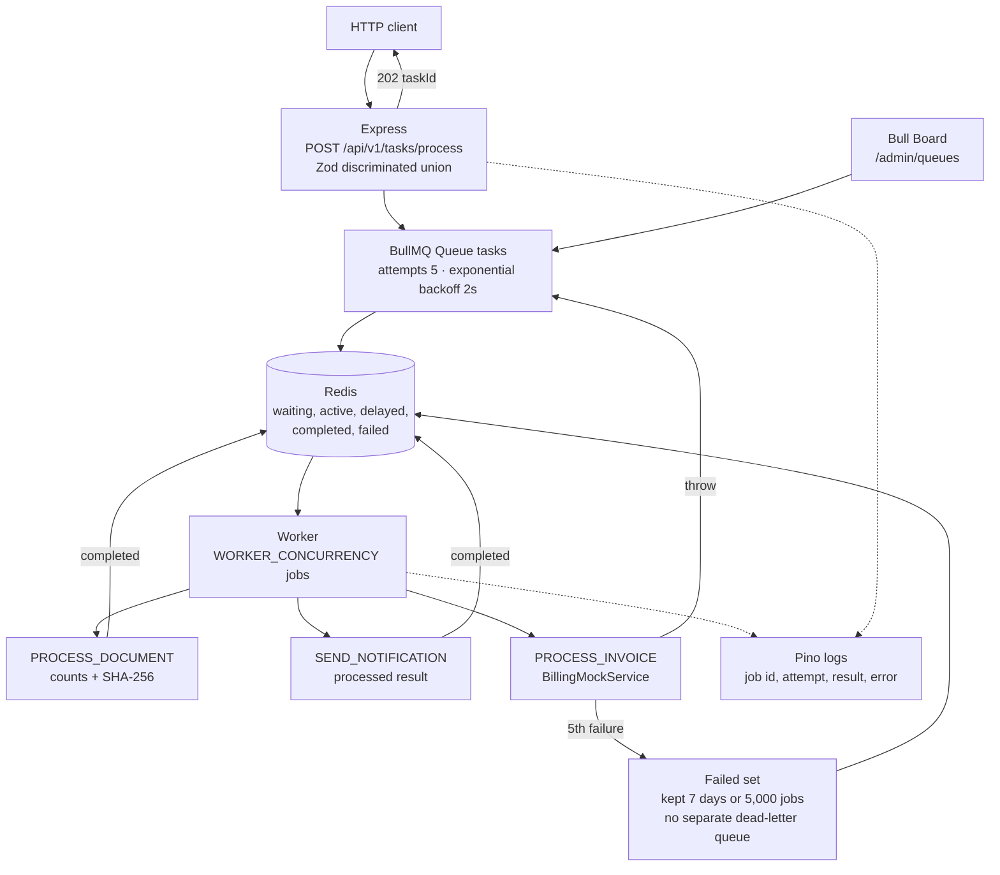

# Distributed Task Queue Engine

One Node.js process accepts background work over HTTP, stores it in Redis through BullMQ, and executes it on an in-process worker. The API returns `202 Accepted` as soon as Redis has the job. Document analysis, notification handling, and a simulated invoice call then run outside the request, with a fixed retry policy and structured logs.

The worker and the HTTP server share a process, a Redis connection configuration, and a deployable. Scaling is horizontal at the process level: additional instances of this service consume the same `tasks` queue. There is no separate message bus, no second database, and no dedicated dead-letter queue. Jobs that exhaust their attempts stay in BullMQ's failed set until the retention limits remove them.

This repository is a working reference for that flow. The invoice handler is a mock that fails on purpose. The notification handler does not call an email provider. `/admin/queues` has no authentication.

## Key Architectural Highlights

- **Queue.** `POST /api/v1/tasks/process` validates the body with a Zod discriminated union on `type`, then calls `Queue.add` on the BullMQ queue named `tasks`. The job name is the task type. BullMQ assigns the id. The handler does not pass a custom `jobId`, so repeating the same HTTP request creates another job. There is no idempotency key.
- **Worker.** `createTaskWorker()` starts a BullMQ `Worker` on `tasks` in the same process as Express. `WORKER_CONCURRENCY` sets how many jobs that process runs at once (default 10, accepted range 1–1000). Startup rejects a value outside that range before the worker starts.
- **Job types.** `PROCESS_DOCUMENT` returns character count, word count, and a SHA-256 of the content. `SEND_NOTIFICATION` validates recipient, subject, and message, then records a processed result. `PROCESS_INVOICE` calls `BillingMockService`, which waits 1.5–3 seconds and throws `BillingServiceException` on about 20 percent of calls. Only that throw is retried. The other two handlers return normally.
- **Retry policy.** Every job is created with `attempts: 5` and exponential backoff starting at 2 seconds. BullMQ computes the delay as `round(2000 * 2^(attemptsMade - 1))` with no jitter: 2s, 4s, 8s, then 16s between the five attempts.
- **Visibility and retention.** The worker does not set `lockDuration`, `stalledInterval`, or `maxStalledCount`. BullMQ 5 defaults apply: a 30 second lock, renewal at 15 seconds, a stalled check every 30 seconds, and `maxStalledCount` of 1. A stalled job is moved back for another attempt; a second stall can fail it. Completed jobs are kept for 24 hours or 1,000 jobs, whichever limit is hit first. Failed jobs are kept for 7 days or 5,000 jobs. Those Redis sets are the execution record. Nothing else stores task state.
- **State machine.** A job moves through BullMQ states in Redis: waiting, active, delayed (while backing off), completed, or failed. The HTTP response does not include the result. Bull Board at `/admin/queues` reads the same queue.

| Task type | Sync check | Worker result | Failure mode |
| --- | --- | --- | --- |
| `PROCESS_DOCUMENT` | `documentId`, `content` (1–1,000,000 chars) | counts, SHA-256, `completedAt` | Returns on the first attempt |
| `SEND_NOTIFICATION` | email, subject, message | `status: "processed"` | Returns on the first attempt. No provider call |
| `PROCESS_INVOICE` | customer, amount, currency, tax id, at least one line item | `PAID`, UUID, fake PDF URL | Throws ~20% of the time so BullMQ retries |

Redis is reached with `ioredis`. `REDIS_URL` (including `rediss://`) wins. Otherwise the client uses `REDIS_HOST`, `REDIS_PORT`, and `REDIS_PASSWORD`. `maxRetriesPerRequest` is `null`, which BullMQ requires for blocking commands. The reconnect delay is `min(500 * 2^min(attempt-1, 6), 30000)` milliseconds.

Express limits JSON bodies to 1 MB and disables `x-powered-by`. A document whose JSON encoding exceeds 1 MB is rejected by the parser before Zod runs. Invalid JSON returns `400`. A Zod failure returns `400` with `issues`. A queue failure falls through to the error middleware and returns `500`.

## Architecture Diagram



`failed` is the terminal BullMQ set for jobs that used all five attempts or stalled past `maxStalledCount`. The application does not declare another queue, and no process consumes that set.

Shutdown order, on `SIGTERM` or `SIGINT`, is HTTP server, worker, queue, then Redis. A second signal is ignored while the first shutdown runs. Docker Compose sets `init: true` so the runtime receives that signal, and `stop_grace_period: 30s` so an in-flight invoice mock can finish before the container is killed.

## Fault Tolerance & Reliability Patterns

**Exponential backoff and retries.** `defaultJobOptions` on the queue sets five attempts and `backoff: { type: 'exponential', delay: 2000 }`. `PROCESS_INVOICE` logs the failure and rethrows. BullMQ then delays the job and increments the attempt. `PROCESS_DOCUMENT` and `SEND_NOTIFICATION` do not use this path unless the worker process itself crashes mid-job.

**Stalled jobs, which is the visibility timeout.** While a job is active, the worker holds a lock. With the library defaults left in place, that lock lasts 30 seconds and is renewed every 15 seconds. If the process dies and stops renewing, the stalled checker (every 30 seconds) returns the job to the queue. The worker logs `Task stalled and will be retried`. `maxStalledCount` is 1, so a job that stalls twice is failed rather than retried forever. There is no separate per-job timeout option in this code. A handler that never settles keeps the lock only as long as the process keeps renewing it.

**Failed-job retention, not a dead-letter queue.** After the last attempt, BullMQ stores the job and the error in the failed set. Retention is 7 days and 5,000 jobs. Completed jobs use 24 hours and 1,000 jobs. No worker moves those jobs to another queue, and nothing replays them automatically. Bull Board is the inspection tool.

**Redis reconnect.** Connection loss is logged at `connect`, `ready`, `reconnecting`, `error`, `close`, and `end`. The retry strategy backs off up to 30 seconds. Startup calls `redis.ping()` and refuses to listen if Redis is unreachable. A later disconnect does not exit the process by itself; ioredis keeps retrying and BullMQ uses that client.

**Graceful shutdown.** The handler closes the HTTP server so it stops accepting connections, then `worker.close()` so active jobs can finish and no new jobs are taken, then `taskQueue.close()`, then `redis.quit()`. Each step logs a failure and sets `process.exitCode` without skipping the remaining steps. Startup failures close the queue and Redis before the process marks itself failed.

**What is not implemented.** There is no idempotency store, no deduplication by `documentId` or `customerId`, no transactional outbox, no circuit breaker around the billing mock, and no authenticated admin API. The SHA-256 on a document is a result field, not a deduplication key. Two identical invoice posts can both reach `PAID` with different invoice ids if the mock succeeds twice.

## Testing Strategy

Vitest runs the suite once (`vitest run`) in the Node environment. `tests/**/*.test.ts` is included. `clearMocks` and `restoreMocks` are on.

The only suite, `tests/task.test.ts`, mounts `taskRouter` on a small Express app and drives it with Supertest. It mocks `src/queues/task.queue.ts` with `vi.mock` before importing the router, so `dispatchTask` never opens Redis and the worker never starts. `add` is stubbed to return a fixed job id.

| Case | Assertion |
| --- | --- |
| `PROCESS_DOCUMENT` with empty `documentId` and `content` | `400`, `error: "Invalid task payload"`, issues for both fields, `add` not called |
| Valid `PROCESS_DOCUMENT` | `202`, `taskId`, `taskType`, `status: "accepted"`, `acceptedAt` string, `add('PROCESS_DOCUMENT', payload)` |
| Valid `PROCESS_INVOICE` | `202` and `add('PROCESS_INVOICE', payload)` |

These tests cover request validation and the accept contract. They do not cover the worker, the billing mock's failure rate, backoff timing, stalled locks, shutdown, Bull Board, or a live Redis. `SEND_NOTIFICATION` has a schema and a handler and no test. Run the suite on the host; the production image excludes `tests/` via `.dockerignore`.

## Local Execution & Docker Setup

Requirements: Node.js 22 for the host toolchain, and Docker Engine with Compose v2 for the stack. The Dockerfile builds on `node:22-alpine` in four stages: full install, `tsc`, production `npm ci --omit=dev`, then a runtime image that runs as `node` with `node dist/src/index.js`.

### Docker Compose

From this directory:

```bash
docker compose up --build
```

Compose starts Redis 7 with AOF on the `queue-net` bridge network and waits until `redis-cli ping` succeeds. The app container then starts with:

| Variable | Value in Compose |
| --- | --- |
| `PORT` | `3000` inside the container |
| `REDIS_URL` | `redis://redis:6379` |
| `WORKER_CONCURRENCY` | `${WORKER_CONCURRENCY:-10}` |
| `LOG_LEVEL` | `${LOG_LEVEL:-info}` |
| `SERVICE_NAME` | `${SERVICE_NAME:-distributed-task-queue}` |

The host port is `${PORT:-3000}`, mapped to container port 3000. Redis is published on `${REDIS_PORT:-6379}` so a host process can use the same broker. Data stays in the `redis_data` volume. The app is healthy when it accepts TCP connections on port 3000. There is no `/health` route; unknown paths return `404`.

The app image does not read a remote `REDIS_URL` from an `.env` file. Compose sets the in-cluster URL explicitly. Do not commit real Redis credentials.

```bash
docker compose down
docker compose down -v
```

`down -v` deletes the Redis volume.

### Host process

```bash
npm install
npm test
npx tsc --noEmit
```

Copy `.env.example` to `.env` and point `REDIS_URL` at a Redis you control. For the Compose Redis from the host, use `redis://127.0.0.1:6379` after `docker compose up redis`.

```bash
npm run dev
```

`dev` runs `tsx watch src/index.ts`. The process pings Redis, starts the worker, then listens.

Submit a document:

```bash
curl -i -X POST http://localhost:3000/api/v1/tasks/process \
  -H "Content-Type: application/json" \
  -d "{\"type\":\"PROCESS_DOCUMENT\",\"documentId\":\"document-42\",\"content\":\"A valid document body.\"}"
```

Expect `202` and a JSON body with `taskId`, `taskType`, `status` equal to `accepted`, and `acceptedAt`. An invoice body uses `customerId`, a positive `amount`, `currency`, `taxId`, and a non-empty `items` array of `description`, positive integer `quantity`, and positive `unitPrice`. A notification body uses `recipient` (email), `subject`, and `message`.

Open `http://localhost:3000/admin/queues` to see waiting, active, delayed, completed, and failed jobs. Put that UI behind an authenticated proxy before exposing it. Logs are Pino JSON on stdout, named `SERVICE_NAME` (default `distributed-task-queue`) at `LOG_LEVEL` (default `info`). They include Redis lifecycle events, each attempt, the worker result, and the error when a job fails. There is no Prometheus or trace exporter.
