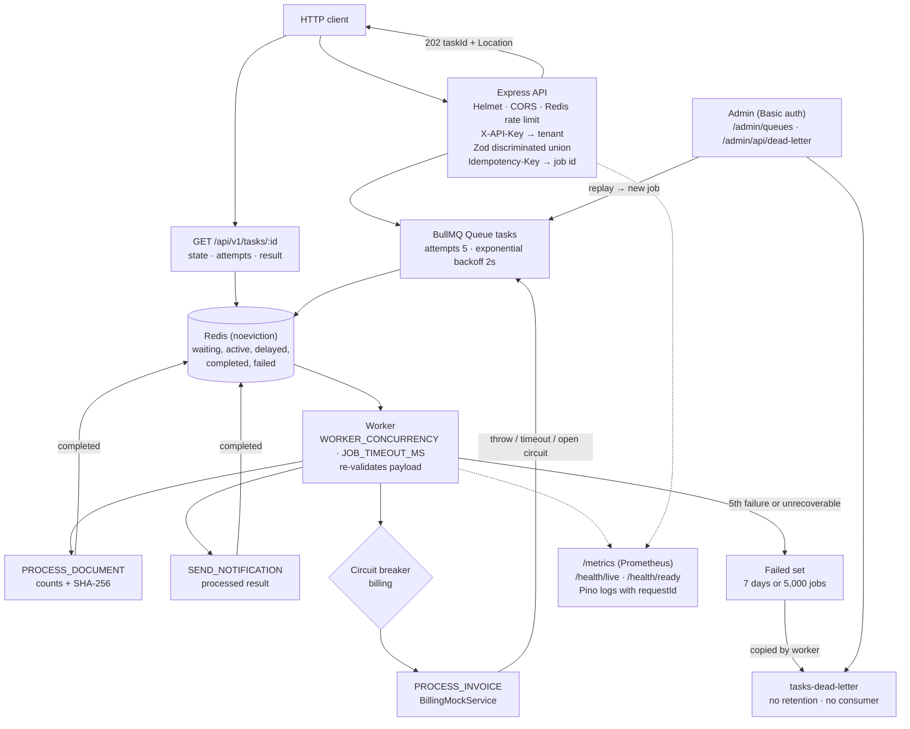

# Distributed Task Queue Engine

One Node.js deployable accepts background work over HTTP, stores it in Redis through BullMQ, and executes it on a BullMQ worker. The API returns `202 Accepted` as soon as Redis has the job. Document analysis, notification handling, and a simulated invoice call then run outside the request, with a fixed retry policy, a per-job timeout, a circuit breaker around billing, a dead-letter queue, Prometheus metrics, and structured logs correlated by request id.

Redis is the only state. There is no second database and no separate message bus. The same image runs in one of three roles selected by `PROCESS_ROLE`: `all` (HTTP and worker in one process, the default), `api` (HTTP only), or `worker` (worker plus `/health` and `/metrics`). Scaling is horizontal at the process level: every worker instance consumes the same `tasks` queue, and every API instance shares the same Redis-backed rate limiter and idempotency keys.

This repository is a working reference for that flow. The invoice handler is a mock that fails on purpose. The notification handler does not call an email provider. The task API is authenticated with per-tenant API keys (mandatory in production) and the admin surface with HTTP Basic auth.

## Key Architectural Highlights

- **Queue.** `POST /api/v1/tasks/process` validates the body with a Zod discriminated union on `type`, then calls `Queue.add` on the BullMQ queue named `tasks`. The job name is the task type. The job data is the validated payload plus a `meta` object: `requestId`, `payloadHash` (SHA-256 of the canonical payload), `acceptedAt`, and, when present, `idempotencyKey` or `replayOf`.
- **Authentication and tenants.** Every task request carries an `X-API-Key` header that must match one of `API_KEYS`. An entry written as `tenantId:key` maps the key to a stable tenant, so several keys can share one tenant and a key can be rotated without losing access to its tasks; a plain `key` entry is its own tenant, identified by `key-<first 16 hex of sha256(key)>`. The tenant is stored in `meta.tenantId`. Optionally, `RATE_LIMIT_TENANT_MAX` caps requests per tenant (all of its keys together) per window. A tenant can only read its own tasks: another tenant's id returns `404`, the same as an unknown id. With `API_KEYS` unset (allowed only outside production) every caller shares the `public` tenant.
- **Idempotency.** An optional `Idempotency-Key` header (1–255 printable ASCII characters) becomes the BullMQ job id `idem-<sha256(tenantId + key)>`, so two tenants can use the same key independently. `Queue.add` with an existing id is atomic and does not create a second job, so concurrent duplicates converge on one job. The service then reads the stored job: same payload hash returns `202` with the original `taskId` and `acceptedAt` plus `Idempotent-Replayed: true`; a different payload returns `409`. The idempotency window equals job retention (see below). Without the header, every request creates a new job.
- **Worker.** `createTaskWorker()` starts a BullMQ `Worker` on `tasks`. `WORKER_CONCURRENCY` sets how many jobs one process runs at once (default 10, accepted range 1–1000). All configuration is parsed once by a Zod schema in `src/config/env.ts`; an invalid value stops the process before it connects to anything.
- **Job types.** `PROCESS_DOCUMENT` returns character count, word count, and a SHA-256 of the content. `SEND_NOTIFICATION` records a processed result. `PROCESS_INVOICE` calls `BillingMockService` through a circuit breaker; the mock waits 1.5–3 seconds and throws `BillingServiceException` with probability `BILLING_FAILURE_RATE` (default 0.2).
- **Payload re-validation.** The worker parses `job.data` with the same Zod schema before executing. Redis is a trust boundary: a malformed job (manual insert, schema drift between deploys) throws BullMQ's `UnrecoverableError` and fails once instead of burning five attempts.
- **Retry policy.** Every job is created with `attempts: TASK_MAX_ATTEMPTS` (default 5) and exponential backoff starting at `TASK_BACKOFF_DELAY_MS` (default 2 seconds). BullMQ computes the delay as `round(delay * 2^(attemptsMade - 1))` with no jitter: with the defaults, 2s, 4s, 8s, then 16s between the five attempts. Billing errors, circuit-open errors, and timeouts are retryable; invalid payloads are not.
- **Per-job timeout.** Each handler runs under `JOB_TIMEOUT_MS` (default 30 seconds) with an `AbortSignal`. The billing mock honours the signal. On expiry the attempt fails with `TaskTimeoutError` and is retried.
- **Visibility and retention.** The worker keeps BullMQ 5 lock defaults: a 30 second lock, renewal at 15 seconds, a stalled check every 30 seconds, and `maxStalledCount` of 1. Completed jobs are kept for 24 hours or 1,000 jobs; failed jobs for 7 days or 5,000 jobs. A job that reaches the terminal failed state is also copied to the `tasks-dead-letter` queue, which has no retention limit.
- **State machine.** A job moves through BullMQ states in Redis: waiting, active, delayed (while backing off), completed, or failed. `GET /api/v1/tasks/:taskId` returns that state, attempts, timestamps, the result, and the failure reason. When the failed set has been trimmed, the endpoint falls back to the dead-letter entry and reports `dead-lettered`.

| Task type           | Sync check                                                 | Worker result                  | Failure mode                                                                                 |
| ------------------- | ---------------------------------------------------------- | ------------------------------ | -------------------------------------------------------------------------------------------- |
| `PROCESS_DOCUMENT`  | `documentId`, `content` (1–1,000,000 chars)                | counts, SHA-256, `completedAt` | Returns on the first attempt                                                                 |
| `SEND_NOTIFICATION` | email, subject, message                                    | `status: "processed"`          | Returns on the first attempt. No provider call                                               |
| `PROCESS_INVOICE`   | customer, amount, currency, tax id, at least one line item | `PAID`, UUID, fake PDF URL     | Throws with probability `BILLING_FAILURE_RATE`; circuit breaker; retried, then dead-lettered |

Redis is reached with `ioredis`. `REDIS_URL` (including `rediss://`) wins. Otherwise the client uses `REDIS_HOST`, `REDIS_PORT`, and `REDIS_PASSWORD`. `maxRetriesPerRequest` is `null`, which BullMQ requires for blocking commands. The reconnect delay is `min(500 * 2^min(attempt-1, 6), 30000)` milliseconds. Compose runs Redis with `maxmemory-policy noeviction`, which BullMQ requires: an evicted queue key is a lost job. The Compose Redis requires `REDIS_PASSWORD` (passed through stdin and `REDISCLI_AUTH`, so it never appears in a process list) and is published on `127.0.0.1` only.

Express disables `x-powered-by`, including on the Bull Board sub-app. The task API applies Helmet headers, CORS (`CORS_ORIGINS`), a rate limiter, API key authentication, and a 1 MB JSON limit, in that order. The limiter runs before authentication, so invalid keys are rate limited too. A missing or unknown API key returns `401`. Invalid JSON returns `400`. A body over 1 MB returns `413`. A Zod failure returns `400` with `issues`. A reused idempotency key with a different payload returns `409`. A queue failure returns `500`. Every error body carries the `requestId`.

## Architecture Diagram



Shutdown order, on `SIGTERM` or `SIGINT`, is HTTP server (idle keep-alive sockets closed), worker (active jobs finish), task queue, dead-letter queue, then Redis. Further signals are logged and ignored while shutdown runs. If shutdown exceeds `SHUTDOWN_TIMEOUT_MS` (default 25 seconds) the process exits with code 1. Compose sets `init: true` so the runtime receives the signal, and `stop_grace_period: 30s`, which is above the shutdown timeout.

## Fault Tolerance & Reliability Patterns

**Exponential backoff and retries.** `defaultJobOptions` sets five attempts and `backoff: { type: 'exponential', delay: 2000 }`. A handler that throws is delayed and retried. `UnrecoverableError` skips the remaining attempts.

**Circuit breaker.** Billing calls go through an in-process breaker. After `CIRCUIT_BREAKER_FAILURE_THRESHOLD` consecutive failures (default 5) it opens and rejects calls with `CircuitOpenError` without touching billing. After `CIRCUIT_BREAKER_RESET_TIMEOUT_MS` (default 30 seconds) it lets one probe through; success closes it, failure reopens it. A rejected call is a failed attempt and follows the normal backoff, so during a long outage jobs reach the dead-letter queue instead of hammering the dependency. State changes are logged and exported as `circuit_breaker_state`. The breaker is per process, not shared through Redis.

**Timeouts.** `withTimeout` races the handler against `JOB_TIMEOUT_MS` and aborts its `AbortSignal`. This bounds handlers that await I/O. It cannot preempt synchronous CPU work; the document handler is bounded by the 1 MB body limit instead.

**Stalled jobs, which is the visibility timeout.** While a job is active, the worker holds a lock renewed every 15 seconds. If the process dies, the stalled checker returns the job to the queue and the worker logs `Task stalled and will be retried`. A job that stalls twice is failed.

**Dead-letter queue.** When a job lands in the terminal failed state (attempts exhausted, unrecoverable, or stalled past the limit), the worker's `failed` handler confirms the state with `job.getState()` and adds a copy to `tasks-dead-letter` with the deterministic id `dlq-<jobId>`, so two workers observing the same failure produce one entry. Nothing consumes that queue. Operators list, replay, or delete entries through `/admin/api/dead-letter`; replay validates the payload against the current schema, enqueues it as a new job with `meta.replayOf`, and removes the entry. The copy is written after BullMQ commits the failure, not in the same Redis transaction: if the process dies in between, the job is still in the failed set for 7 days but has no dead-letter entry.

**Redis reconnect and readiness.** Connection events are logged. Startup pings Redis with a 10 second timeout and exits with code 1 if unreachable; Compose restarts the container. After startup, a disconnect does not exit the process; ioredis keeps retrying and `/health/ready` returns `503` until Redis answers a ping within one second. `/health/live` never touches Redis, so an outage does not restart healthy processes.

**Graceful shutdown.** See the shutdown order above. Each step logs a failure, sets `process.exitCode`, and does not skip the remaining steps. A startup failure runs the same sequence. `uncaughtException` logs and shuts down; `unhandledRejection` is logged.

## API Reference

| Method & path                                | Auth                      | Purpose                                                                                        |
| -------------------------------------------- | ------------------------- | ---------------------------------------------------------------------------------------------- |
| `POST /api/v1/tasks/process`                 | `X-API-Key`, rate-limited | Enqueue a task. Optional `Idempotency-Key`, optional `X-Request-Id`. `202` with `Location`     |
| `GET /api/v1/tasks/:taskId`                  | `X-API-Key`, rate-limited | Task state, attempts, timestamps, result, failure reason. `404` for other tenants' tasks       |
| `GET /health/live`                           | none                      | Liveness. Always `200` while the event loop responds                                           |
| `GET /health/ready`                          | none                      | Readiness: not shutting down, Redis ping, worker running. `200` or `503` with per-check detail |
| `GET /metrics`                               | none                      | Prometheus exposition (disable with `METRICS_ENABLED=false`)                                   |
| `GET /admin/queues`                          | Basic                     | Bull Board for `tasks` and `tasks-dead-letter` (read-only)                                     |
| `GET /admin/api/dead-letter?limit&offset`    | Basic                     | Paginated dead-letter entries, including each entry's `tenantId`                               |
| `POST /admin/api/dead-letter/:taskId/replay` | Basic                     | Re-enqueue as a new job owned by the original tenant; `202` with `taskId` and `replayOf`       |
| `DELETE /admin/api/dead-letter/:taskId`      | Basic                     | Discard an entry; `204`                                                                        |
| `GET /admin/api/audit?limit`                 | Basic                     | Newest admin audit records (1–1000, default 100)                                               |

The admin surface returns `503` until `ADMIN_PASSWORD` (at least 12 characters) is configured, so a default deployment never exposes it anonymously. Credentials are compared in constant time. After `ADMIN_AUTH_MAX_FAILURES` rejected logins (default 10) from one client IP within `ADMIN_AUTH_WINDOW_MS` (default 15 minutes), every `/admin` request from that IP returns `429` until the window ends; successful requests, such as Bull Board's polling, are not counted. Only the `api` and `all` roles mount the task and admin routes.

**Admin audit trail.** Every sensitive admin action is recorded: dead-letter list, replay and delete (with outcome `success`, `not_found`, `invalid` or `error`), failed logins (`admin.auth_failed`), lockouts (`admin.auth_locked`), requests while the admin surface is disabled (`admin.disabled`), Bull Board write actions (`admin.bull_board_action`) and reads of the audit log itself. Each record has `timestamp`, `action`, `outcome`, `actor` (the authenticated admin user, or `null`), `requestId`, `method`, `path`, client `ip`, `statusCode` and, when relevant, `tenantId`, `taskId` and `newTaskId`. Passwords, `Authorization` headers, API keys and payloads are never recorded. Records are written as structured log lines with `audit: true` (ship them to your SIEM) and appended to the capped Redis stream `<SERVICE_NAME>:audit:admin` (`AUDIT_LOG_MAX_ENTRIES`, `0` = logs only), readable through `GET /admin/api/audit`. A Redis write failure is logged and never fails the admin request.

## Observability

Logs are Pino JSON on stdout with `service` and `role` on every line. `pino-http` logs each request with its `X-Request-Id` (accepted from the client when it matches `[A-Za-z0-9._-]{1,128}`, otherwise generated, and always echoed). The same id is stored in `job.data.meta.requestId` and appears on worker logs, so one request can be followed from HTTP to the last attempt. `Authorization`, cookies, `Idempotency-Key`, `X-API-Key`, and password fields are redacted. Health and metrics requests are not logged.

| Metric                             | Type      | Labels                                            |
| ---------------------------------- | --------- | ------------------------------------------------- |
| `http_request_duration_seconds`    | histogram | `method`, `route`, `status_code`                  |
| `tasks_enqueued_total`             | counter   | `task_type`, `replayed`                           |
| `tasks_processed_total`            | counter   | `task_type`, `outcome` (one per attempt)          |
| `task_processing_duration_seconds` | histogram | `task_type`, `outcome`                            |
| `tasks_dead_lettered_total`        | counter   | `task_type`                                       |
| `circuit_breaker_state`            | gauge     | `circuit` (0 closed, 1 half-open, 2 open)         |
| `queue_jobs`                       | gauge     | `queue`, `state` (read from Redis at scrape time) |

Node.js runtime metrics (event loop lag, heap, GC) are included. Successful `GET /admin/queues/**` requests (Bull Board polls every few seconds) are logged at `debug` instead of `info`; errors on them are still `warn`/`error`.

**Distributed tracing (optional).** With `OTEL_ENABLED=true` the process registers the OpenTelemetry SDK with an OTLP/HTTP exporter (`OTEL_EXPORTER_OTLP_ENDPOINT`, default `http://localhost:4318`; the standard `OTEL_EXPORTER_OTLP_*` variables such as headers also apply). Each HTTP request becomes a `SERVER` span named after its route; the W3C `traceparent` is accepted from clients, stored in the job `meta`, and every task attempt runs in a `CONSUMER` span that continues the same trace, so one trace covers HTTP → queue → worker. Log lines inside a span carry `traceId` and `spanId`. With tracing disabled (the default) the SDK is not loaded and the instrumentation is a no-op, so no collector is needed.

## Configuration

| Variable                                           | Default                           | Notes                                                                                                                                                   |
| -------------------------------------------------- | --------------------------------- | ------------------------------------------------------------------------------------------------------------------------------------------------------- |
| `NODE_ENV`                                         | `development`                     | The image sets `production`                                                                                                                             |
| `PORT`                                             | `3000`                            |                                                                                                                                                         |
| `PROCESS_ROLE`                                     | `all`                             | `all`, `api`, or `worker`                                                                                                                               |
| `REDIS_URL`                                        | —                                 | Wins over host/port/password                                                                                                                            |
| `REDIS_HOST` / `REDIS_PORT` / `REDIS_PASSWORD`     | `127.0.0.1` / `6379` / —          | `REDIS_PASSWORD` is required by Docker Compose                                                                                                          |
| `WORKER_CONCURRENCY`                               | `10`                              | 1–1000                                                                                                                                                  |
| `JOB_TIMEOUT_MS`                                   | `30000`                           | 1,000–600,000                                                                                                                                           |
| `SHUTDOWN_TIMEOUT_MS`                              | `25000`                           | Keep below the orchestrator grace period                                                                                                                |
| `BILLING_FAILURE_RATE`                             | `0.2`                             | 0–1; `1` forces every invoice to the dead-letter queue                                                                                                  |
| `CIRCUIT_BREAKER_FAILURE_THRESHOLD`                | `5`                               |                                                                                                                                                         |
| `CIRCUIT_BREAKER_RESET_TIMEOUT_MS`                 | `30000`                           |                                                                                                                                                         |
| `RATE_LIMIT_WINDOW_MS` / `RATE_LIMIT_MAX`          | `60000` / `300`                   | Per client IP, shared through Redis. `0` disables                                                                                                       |
| `TRUST_PROXY`                                      | `0`                               | Proxy hops to trust for the client IP                                                                                                                   |
| `CORS_ORIGINS`                                     | `*`                               | Comma-separated list or `*`                                                                                                                             |
| `API_KEYS`                                         | —                                 | Comma-separated `key` or `tenantId:key` entries, 32+ characters per key, no duplicates. Required when `NODE_ENV=production` and the role serves the API |
| `ADMIN_USERNAME` / `ADMIN_PASSWORD`                | `admin` / —                       | Admin disabled until the password is set                                                                                                                |
| `ADMIN_AUTH_MAX_FAILURES` / `ADMIN_AUTH_WINDOW_MS` | `10` / `900000`                   | Failed admin logins per client IP before `429`                                                                                                          |
| `AUDIT_LOG_MAX_ENTRIES`                            | `10000`                           | Approximate cap of the admin audit stream in Redis; `0` keeps audit in logs only                                                                        |
| `TASK_MAX_ATTEMPTS` / `TASK_BACKOFF_DELAY_MS`      | `5` / `2000`                      | Attempts per task (1–50) and base of the exponential backoff (10–600,000 ms)                                                                            |
| `RATE_LIMIT_TENANT_MAX`                            | `0`                               | Requests per tenant per `RATE_LIMIT_WINDOW_MS`, shared through Redis; `0` disables                                                                      |
| `OTEL_ENABLED` / `OTEL_EXPORTER_OTLP_ENDPOINT`     | `false` / —                       | Optional OpenTelemetry tracing over OTLP/HTTP                                                                                                           |
| `METRICS_ENABLED`                                  | `true`                            |                                                                                                                                                         |
| `LOG_LEVEL` / `SERVICE_NAME`                       | `info` / `distributed-task-queue` |                                                                                                                                                         |

## What Is Not Implemented

There is no transactional outbox: the API writes to Redis only, so there is nothing to keep consistent with. API keys are static configuration: there is no self-service key issuance, no automatic expiry (rotate by adding the new key under the same tenant and removing the old one), and no admin RBAC/SSO beyond one Basic-auth operator. The idempotency window ends when BullMQ's retention removes the job. Results live only as long as that retention. The circuit breaker and timeouts are per process. The dead-letter copy is not atomic with the failure (see above). The audit stream is capped and lives in the same Redis; for tamper-evident, long-term retention ship the `audit: true` log lines to external storage. The billing service is a mock and notifications are not sent. There is no OpenAPI document and no Helm/Kubernetes manifests.

## Testing Strategy

There are two Vitest suites and both run in CI.

**Unit suite** (`npm test`, `npm run test:coverage`): Node environment with `NODE_ENV=test` and `LOG_LEVEL=silent`; `.env` is never loaded while Vitest runs. Redis and the queues are replaced with `vi.mock` stubs, so no test opens a connection. Coverage (V8) is enforced at 80% lines, statements and functions and 70% branches over `src/` (`src/index.ts`, the process wiring, is covered by the integration and Docker smoke tests instead); the run fails below those thresholds. The HTML report lands in `coverage/`.

| Suite                           | Covers                                                                                                                                                                                                                                                     |
| ------------------------------- | ---------------------------------------------------------------------------------------------------------------------------------------------------------------------------------------------------------------------------------------------------------- |
| `tests/task.test.ts`            | Full app via Supertest: validation, all three task types, idempotent replay and `409`, malformed key and JSON, `413`, queue failure `500`, status and dead-letter fallback, API key `401`, tenant isolation, key rotation (`tenant:key`), per-tenant quota |
| `tests/task.processor.test.ts`  | Worker handler: results, retryable billing error, `UnrecoverableError`, timeout with aborted signal, breaker short-circuit                                                                                                                                 |
| `tests/circuit-breaker.test.ts` | Threshold, success reset, single half-open probe, reopen on failed probe                                                                                                                                                                                   |
| `tests/operations.test.ts`      | Health, metrics, roles, admin `503`/`401`/`200`, lockout `429`, dead-letter list/replay/delete with their audit records (no secrets), audit endpoint auth, rate limit, dead-letter routing                                                                 |
| `tests/observability.test.ts`   | Trace propagation HTTP → job meta → worker span; audit log lines, Redis stream persistence and error tolerance                                                                                                                                             |
| `tests/bootstrap.test.ts`       | Shutdown ordering, error tolerance, timeout and single run; server close with keep-alive; readiness checks; Redis rate-limit store                                                                                                                         |
| `tests/config.test.ts`          | Defaults, invalid values, `API_KEYS` parsing (`tenant:key`, duplicates, length), retry settings                                                                                                                                                            |

**Integration suite** (`npm run test:integration`, config `vitest.integration.config.ts`): runs the real app, queues and worker against a real Redis, one file at a time, with fast retry settings (3 attempts, 100 ms backoff, breaker threshold 2). Every test starts from an empty database (`FLUSHDB`) and zeroed metrics, so the suite is deterministic. It refuses to start against a Redis that already holds keys (set `TEST_REDIS_ALLOW_FLUSH=true` only for a disposable database) and fails fast with instructions if Redis is unreachable.

| Suite                     | Covers                                                                                                                                                                                                                   |
| ------------------------- | ------------------------------------------------------------------------------------------------------------------------------------------------------------------------------------------------------------------------ |
| `health.int.test.ts`      | `/health/live`, `/health/ready`; Redis unresponsive (`CLIENT PAUSE`) → `503` while live stays `200`, then recovery; reconnection after `CLIENT KILL`; `/metrics`; `X-Request-Id` echo                                    |
| `api.int.test.ts`         | `401` without/with unknown key, tenant isolation and rotated keys, idempotent `202` replay and `409`, per-tenant idempotency, `400` validation, request id stored in the job                                             |
| `processing.int.test.ts`  | The three task types complete with schema-valid results; retries with measured exponential backoff until `failed`; circuit opens (`circuit_breaker_state` = 2) and later invoices fail without calling billing           |
| `dead-letter.int.test.ts` | Dead-letter copy with `tenantId` and `requestId`, `tasks_dead_lettered_total`, replay (`202`, new job, read by the original tenant, `404` for others, entry removed), delete, audit records in Redis without credentials |
| `shutdown.int.test.ts`    | Real HTTP listener: request id propagation, readiness `503` during shutdown, active job drained before Redis closes, ordered steps, new connections refused                                                              |

Run it locally with a disposable Redis on `127.0.0.1:6380`:

```bash
npm run redis:test:up        # docker run --rm redis:7-alpine on 127.0.0.1:6380
npm run test:integration
npm run redis:test:down
```

Use `TEST_REDIS_URL` to point at another disposable Redis. The production image excludes `tests/` via `.dockerignore`.

### Quality gates and CI

```bash
npm run lint            # ESLint: typescript-eslint strict + stylistic type-checked rules
npm run format:check    # Prettier (npm run format to fix)
npm run typecheck
npm run test:coverage   # unit tests + coverage thresholds
npm run check           # all of the above
npm run ci              # check + integration tests + build (needs the test Redis)
```

`.github/workflows/ci.yml` runs three jobs on every push to `main`, every pull request and on demand: **quality** (lint, format, typecheck, unit tests with coverage thresholds and the report as an artifact, build, `npm audit` of production dependencies), **integration** (the integration suite against a `redis:7-alpine` service container) and **image**, which runs only when both pass: it builds the Compose stack with `--scale worker=2`, smoke-tests health, metrics, `401`/`400`, a task through to `completed`, admin `401` and the audit API, then stops the stack and fails if any app container did not exit cleanly.

To run the same pipeline locally, use `npm run redis:test:up` followed by `npm run ci`, or run the workflow itself with [act](https://github.com/nektos/act) (`act -j quality`, `act -j integration`).

## Local Execution & Docker Setup

Requirements: Node.js 22 for the host toolchain, and Docker Engine with Compose v2 for the stack. The Dockerfile builds on `node:22-alpine` in four stages: full install, `tsc`, production `npm ci --omit=dev`, then a runtime image that runs as `node` with `node dist/src/index.js` and a `HEALTHCHECK` on `/health/ready`.

### Docker Compose

Copy `.env.example` to `.env` and set at least `REDIS_PASSWORD`, `API_KEYS`, and `ADMIN_PASSWORD` (Compose refuses to start without the first two). Generate each value with:

```bash
node -e "console.log(require('crypto').randomBytes(32).toString('base64url'))"
```

Then, from this directory:

```bash
docker compose up --build
```

Compose starts Redis 7 with AOF, `noeviction`, and `requirepass` on the `queue-net` bridge network and waits until an authenticated `redis-cli ping` succeeds. The app container starts with `PROCESS_ROLE=all`, `REDIS_HOST=redis` plus `REDIS_PASSWORD`, and every variable in the configuration table forwarded from your shell or `.env` (defaults shown above). It is healthy when `/health/ready` returns `200`. The host port is `${PORT:-3000}`; Redis is published on `127.0.0.1:${REDIS_PORT:-6379}`. Data stays in the `redis_data` volume.

Optional profiles:

```bash
docker compose --profile scale-out up --build       # adds a PROCESS_ROLE=worker container
docker compose --profile scale-out up --build --scale worker=3
docker compose --profile observability up --build   # adds Prometheus on ${PROMETHEUS_PORT:-9090}
```

The app image never reads `REDIS_URL` from `.env`; Compose blanks it and points the containers at the in-network Redis. Do not commit real Redis credentials, API keys, or the admin password.

```bash
docker compose down
docker compose down -v
```

`down -v` deletes the Redis volume.

### Host process

```bash
npm install
npm run check      # lint + format check + typecheck + unit tests with coverage
```

Copy `.env.example` to `.env`. **`REDIS_URL` vs `REDIS_PASSWORD`:** inside Docker Compose the containers always use the in-network Redis with `REDIS_PASSWORD` and ignore `REDIS_URL`. On the host, `REDIS_URL` wins when it is set: leave it empty to use the Compose Redis (`docker compose up redis`, published on `127.0.0.1:${REDIS_PORT:-6379}` and authenticated with the same `REDIS_PASSWORD`), or set it to reach another Redis (for example a managed `rediss://` instance). The same `.env` serves both, as long as `REDIS_URL` is empty when you want the Compose Redis.

To rotate a legacy (plain) API key without losing its tasks, compute its tenant id and map the new key to it:

```bash
node -e "console.log('key-'+require('crypto').createHash('sha256').update(process.argv[1]).digest('hex').slice(0,16))" <old-key>
# API_KEYS=<old-key>,key-<hash>:<new-key>   then, once clients moved: API_KEYS=key-<hash>:<new-key>
```

```bash
npm run dev        # tsx watch src/index.ts
npm run build && npm start
```

The process validates configuration, pings Redis, starts the worker (unless `PROCESS_ROLE=api`), then listens.

Submit a document and read its status (omit `X-API-Key` only when `API_KEYS` is unset in development):

```bash
curl -i -X POST http://localhost:3000/api/v1/tasks/process \
  -H "Content-Type: application/json" \
  -H "X-API-Key: <one of API_KEYS>" \
  -H "Idempotency-Key: document-42-v1" \
  -d "{\"type\":\"PROCESS_DOCUMENT\",\"documentId\":\"document-42\",\"content\":\"A valid document body.\"}"

curl -s -H "X-API-Key: <one of API_KEYS>" http://localhost:3000/api/v1/tasks/<taskId>
```

Expect `202` with `taskId`, `taskType`, `status: "accepted"`, `acceptedAt`, and a `Location` header. Repeating the first request returns the same `taskId` with `Idempotent-Replayed: true`. An invoice body uses `customerId`, a positive `amount`, `currency`, `taxId`, and a non-empty `items` array of `description`, positive integer `quantity`, and positive `unitPrice`. A notification body uses `recipient` (email), `subject`, and `message`.

Open `http://localhost:3000/admin/queues` with the admin credentials to see both queues. Put it behind TLS before exposing it beyond localhost; Basic auth sends the password on every request.

### Git setup

The repository ships a `.gitignore` (`node_modules`, `dist`, `coverage`, `.env`, `.env.*` except `.env.example`) and a `.gitattributes` that keeps LF line endings, which Prettier enforces. To start version control and enable CI:

```bash
git init -b main
git add .
git status            # confirm .env is NOT listed
git commit -m "Initial import"
git remote add origin https://github.com/<you>/<repo>.git
git push -u origin main   # triggers .github/workflows/ci.yml
```
